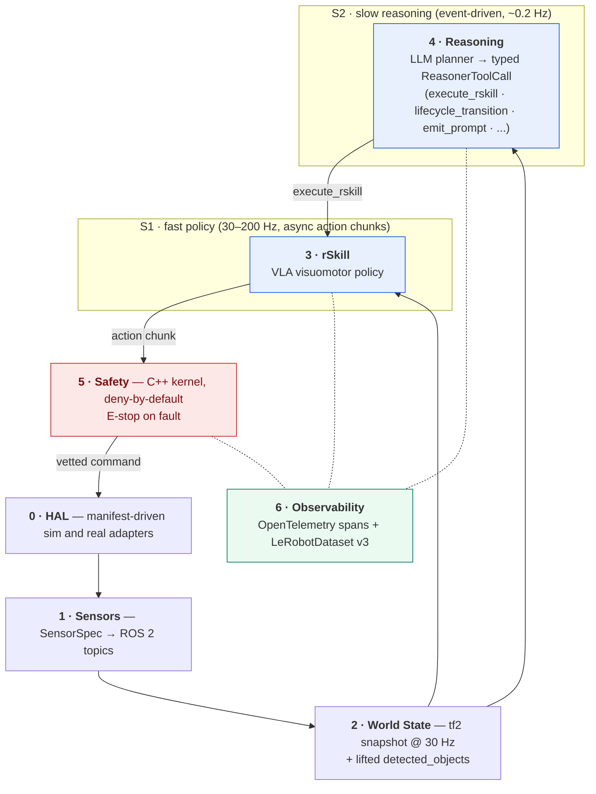

<div align="center">


# OpenRAL

**The open harness for physical AI.** OpenRAL is the open-source **Robot Agentic Layer** (harness) for embodied AI — it unifies fast policies, slow reasoning, reward signals, perception AI and classical control into one typed, traceable, safety-first runtime for deployable robot agents. One fixed harness, swappable **rSkills**.

[](https://openral.com)
[](https://github.com/OpenRAL/openral/actions/workflows/docker-build.yml?query=branch%3Amaster)
[](https://docs.ros.org/en/jazzy/)
[](LICENSE)
[](pyproject.toml)
[](https://github.com/huggingface/lerobot)
[](docker/inference/Dockerfile.x86)
[](docker/inference/Dockerfile.x86)
[](https://docs.openral.com/)
[](https://huggingface.co/OpenRAL)
[](https://discord.gg/3paXT2bVyB)

[Quick start](#quick-start) · [Tutorials](docs/tutorials/sim/first-rollout.md) · [Architecture](#architecture) · [Robots](docs/reference/robots.md) · [rSkills](docs/reference/rskills.md) · [Reasoner](docs/reference/reasoner.md) · [Sim envs](docs/reference/sim-environments.md) · [Telemetry](docs/reference/telemetry.md) · [Discord](https://discord.gg/3paXT2bVyB) · [Docs](https://docs.openral.com/)

</div>

<div align="center">

### See it run


<sub>A randomized grid of real eval runs — benchmarks, simulation, and on-hardware deployment. Watch the full scored showcase (SUCCESS / FAIL, per rSkill) at <a href="https://openral.com/#showcase">openral.com</a>.</sub>

</div>

---

## What is OpenRAL?

A VLA alone is not an agent; OpenRAL wraps it in the loop it needs. It is a typed, layered runtime between a robot's motor API and a task planner:

- **Typed runtime**: seven layers (HAL, Sensors, World State, rSkill, Reasoning, Safety, Observability) with Pydantic v2 contracts at every boundary.
- **rSkills**: every capability is a Hugging Face Hub package with weights, a `rskill.yaml` manifest, latency budgets and reproducible eval. VLAs, detectors, scene VLMs, reward monitors, MoveIt 2 / Nav2 actions and reasoner playbooks install the same way: `openral rskill install OpenRAL/rskill-smolvla-franka_panda-libero_spatial-bf16`.
- **Dual system**: a slow, provider-agnostic LLM reasoner (S2) emits typed tool calls; a fast visuomotor policy (S1, 30-200 Hz) executes dispatched skills. Replanning is bounded and logged.
- **Safety kernel**: a separate, deny-by-default C++ process with an independent deadman watchdog. Python proposes; C++ disposes.

OpenRAL composes ROS 2, tf2, MoveIt 2, Nav2, Isaac ROS and `ros2_control` instead of reinventing them. Every workspace package ships at one lockstep version. Live status: [roadmap](docs/roadmap/index.md) and the [repo state map](docs/architecture/repo-state-map.html).

---

## Features

| Capability | What you get | Docs |
|---|---|---|
| Robot manifests | `RobotDescription` (Pydantic v2) per robot: joints, links, sensors, embodiment tags; 27 under `robots/` | [Robots](docs/reference/robots.md) |
| rSkills | Installable policies, detectors, VLMs, reward monitors, ROS actions, playbooks | [rSkills](docs/reference/rskills.md) |
| Sim and benchmarks | `openral sim run` and `openral benchmark run`: one YAML, a reproducible rollout, video + metrics + eval JSON | [Sim environments](docs/reference/sim-environments.md) |
| Reasoner (S2) | Model-first LLM planner, closed capability-gated tool palette, bounded replanning | [Reasoner](docs/reference/reasoner.md) |
| Perception and navigation | Open-vocabulary detectors lifted into world state, scene VLM, SLAM, Nav2, optional cuMotion planning | [Sensors](docs/reference/sensors_landscape.md) |
| Safety | C++ kernel (limits, workspace, self/world collision), deadman watchdog, E-stop, optional SROS2 | [Overview](docs/architecture/overview.md), [ROS graph security](docs/reference/ros-graph-security.md) |
| Observability | OpenTelemetry traces, the on-robot dashboard, a compliance log, a LeRobotDataset v3 recorder | [Dashboard](docs/quickstart/dashboard.md), [Telemetry](docs/reference/telemetry.md) |
| CLI | `uv run openral --help`: `doctor`, `detect`, `rskill`, `sim`, `benchmark`, `deploy`, `dashboard`, `robot`, `security`, `compliance`, ... | [Toolchain](docs/contributing/toolchain.md) |

---

## Quick start

Needs Linux (Ubuntu 24.04 recommended) and [`just`](https://github.com/casey/just). Full walk-through: [Quickstart](docs/quickstart/index.md).

```bash
git clone https://github.com/OpenRAL/openral && cd openral
just bootstrap                 # uv + ROS 2 Jazzy + system deps
just sync --group sim          # workspace + simulators (always `just sync`, never bare `uv sync`)
uv run openral doctor          # check the host
```

Then run a policy in simulation: [Your first sim rollout](docs/tutorials/sim/first-rollout.md) (CPU only, one command). To drive a real robot, see [Deploy on a robot](docs/tutorials/deploy/deploy-run-and-dashboard.md); to probe hardware, run `uv run openral detect` ([wizard guide](python/detect/README.md)).

Other ways in, a no-clone CLI install and the x86 Docker deploy image: [Quickstart, other install paths](docs/quickstart/index.md#other-install-paths).

---

## Architecture



Pydantic schemas in `python/core/` are the layer contracts. Details: [Architecture overview](docs/architecture/overview.md), [repo map](docs/architecture/repo-map.md).

---

## What is supported

Counts come from the repo; the linked pages hold the full tables.

- **Robots (27 manifests in `robots/`)**: SO-100/101, Franka Panda, UR5e/UR10e, Sawyer, ALOHA and AgileX, OpenArm v2 and Anvil OpenARM 2.0, Galaxea A1 and R1 Pro, Flexiv Rizon 4 and dual Rizon, MakerMods Metal, Unitree H1 / G1 / H2, Fourier GR1, OpenAMRobot 2.0, Google Robot, WidowX, and mobile bases. Sim and real status per robot: [Robots](docs/reference/robots.md).
- **VLA policy families**: SmolVLA, pi0.5, GR00T (N1.7 and the BEHAVIOR-1K checkpoint), xVLA, MolmoAct2, ACT, Diffusion Policy, 3D Diffuser Actor, OpenVLA(-OFT), RLDX-1, NaT VLA, Cosmos 3, LingBot-VLA 1/2 and LingBot-VA, Xiaomi XR-1, InternVLA-N1. Licenses and runtime pins: [VLA compatibility](docs/reference/vla_compatibility.md).
- **Simulators**: LIBERO, MetaWorld, ManiSkill3, SimplerEnv, RoboCasa, RoboTwin 2.0, VLABench, gym-aloha, gym-pusht, Isaac Sim, BEHAVIOR-1K / OmniGibson, RLBench. Index: [Sim environments](docs/reference/sim-environments.md).
- **Sensors**: RealSense D435 / D435i / D415, Luxonis OAK-D Pro, Stereolabs ZED mini, Arducam B0495, USB UVC (incl. Logitech C920), Robotiq FT-300. Catalog and roadmap: [Sensors](docs/reference/sensors_landscape.md).
- **Reasoner models**: Claude, GPT, Cosmos 3 Edge and Qwen3.5 are curated; OpenRouter and Ollama Cloud models are offered unmeasured. Selection: [Reasoner](docs/reference/reasoner.md).
- **Deploy image**: one public image, `docker/inference/Dockerfile.x86` (x86_64 + NVIDIA GPU, driver >= 580.65, CUDA 13, ROS 2 Jazzy). CPU-only and Jetson images are not shipped; Apple Silicon is a development host only. Other aarch64 hosts: [aarch64 support](docs/reference/aarch64-support.md).

---

## Safety

**Python proposes, C++ disposes.** A candidate action chunk passes a Python supervisor, then the C++ safety kernel: joint position, velocity and torque limits, Cartesian workspace and end-effector speed, NaN/Inf rejection, self/world/voxel collision (including predictive checks), and freshness gates that drop a chunk on stale state. An independent deadman watchdog survives a kernel crash and the deploy graph will not start without it. An E-stop latches until an explicit, cooldown-gated reset. A hardware E-stop bridge ships but no per-vendor pendant driver does; without one it reports not-ready. Acceleration/jerk limits and formal certification remain open work.

`deploy run` keeps the robot's ROS graph on this host: an unauthenticated graph on the LAN lets any peer command the arm. A multi-machine graph needs `OPENRAL_ALLOW_NETWORK_ROS=1` and SROS2 (`openral security init`); see [ROS graph security](docs/reference/ros-graph-security.md).

---

## Open and OpenRAL Pro

The public repo is uniformly Apache-2.0 and ships the protocols plus the extension seams. Commercial capabilities live in the private `OpenRAL/openral-pro` monorepo and plug in through the `openral.runtime_backends`, `openral.policy_attach_hooks`, `openral.detector_tiers` and `openral.pro_modules` entry-point groups. Open code never imports `openral_pro*` (`tools/check_no_pro_imports.py`).

| Capability | Where it lives |
|---|---|
| fp32 / fp16 / bf16 weights, PyTorch / ONNX runtimes | open |
| Weight formats of 8 bits or fewer (int8, fp8, NF4, nvfp4) | Pro; quantized rSkills stay in the catalog and refuse to load without it |
| TensorRT engine runtime, GStreamer / DeepStream NVMM zero-copy path | Pro (open has the entry-point seam and deploy-scene knobs) |
| World Action Model (WAM) implementations | Pro |
| Fleet / cloud dispatch, premium rSkills | Pro |
| Safety-kernel contact exemptions that relax a verdict | Pro, behind the kernel's exemption-provider interface; every refusal-only check is open |

Rationale: [Design decisions](docs/decisions.md).

---

## Contributing and community

- Setup: [Development guide](docs/contributing/development.md), [toolchain cheatsheet](docs/contributing/toolchain.md), [test tiers](tests/README.md). Run `just test && just lint` before a PR.
- Rules: [CONTRIBUTING.md](CONTRIBUTING.md) and the engineering playbook [CLAUDE.md](CLAUDE.md). Search the [public-symbol inventory](docs/METHODS.md) before adding a helper.
- [Discord](https://discord.gg/3paXT2bVyB) for questions; [hello@openral.com](mailto:hello@openral.com) for general enquiries.
- Security and safety disclosures: [private vulnerability reporting](https://github.com/OpenRAL/openral/security/advisories/new) or [security@openral.com](mailto:security@openral.com), never a public issue. Conduct reports: [conduct@openral.com](mailto:conduct@openral.com).

See also [SUPPORT.md](SUPPORT.md) and [GOVERNANCE.md](GOVERNANCE.md).

## License

Apache-2.0, see [LICENSE](LICENSE). Third-party model weights keep their upstream licenses (Apache-2.0, MIT, NVIDIA non-commercial, ...); the loader shows each weight's license at install time.
