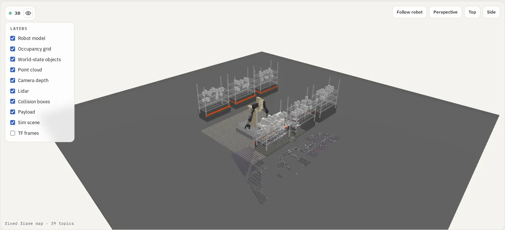

# Sim environments

Scene YAMLs under [`scenes/`](https://github.com/OpenRAL/openral/tree/master/scenes) follow a three-tier hierarchy, `DeployScene ⊆ SimScene ⊆ BenchmarkScene`. Each tier has its own directory, loader gate and CLI command. This page is the per-file catalogue, one row per YAML, plus the benchmark suite table and the rules the tiers share. The directory layout and commands are in [`scenes/README.md`](https://github.com/OpenRAL/openral/tree/master/scenes/README.md); backend installs are in [Sim backend installs](sim-backend-installs.md).

## Tiers and commands

| Tier | Directory | Command | Output |
| --- | --- | --- | --- |
| `DeployScene` | `scenes/deploy/` | `openral deploy sim` (sim) or `openral deploy run` (real hardware) | A live ROS graph; the reasoner picks the rSkill |
| `SimScene` | `scenes/sim/` | `openral sim run --rskill <name>` | `EpisodeResult`s; `summary.json` with `--save-dir` |
| `BenchmarkScene` | `scenes/benchmark/` | `openral benchmark scene --rskill <name>` | `rskills/<dir>/eval/scene_<scene_id>.json` |
| Suite (`list[BenchmarkScene]`) | `benchmarks/` | `openral benchmark run --suite <id> --rskill <name>` | `rskills/<dir>/eval/<suite_id>.json` |

Override flags: `sim run` takes `--task`, `--instruction`, `--max-steps`, `--n-episodes`, `--seed` and `--robot` (free-axis scenes only). `benchmark scene` takes only `--n-episodes`; `benchmark run` takes `--task` and `--n-episodes`. A lowered `--n-episodes` is for iteration, not paper numbers.

## Physics backends

`SceneSpec.backend` is a `PhysicsBackend` label. The runtime dispatches on `scene.id`, not on the label, so the label does not select an engine. Only the `--keep-sim-open` check reads it (Isaac).

| Value | Status |
| --- | --- |
| `mujoco` | Wired; the default (LIBERO, MetaWorld, RoboCasa, ALOHA, custom MJCF, VLABench) |
| `sapien` | Wired (ManiSkill3, SimplerEnv, RoboTwin; some scenes still declare `mujoco`) |
| `isaacsim` | Wired (`isaac_sim`, `behavior`); out-of-process sidecar |
| `coppeliasim` | Wired (RLBench); out-of-process sidecar |
| `mock` | Wired for the `mock` scene (no physics, wiring tests); no shipped YAML uses it |
| `mujoco_mjx`, `pybullet`, `genesis` | Declared but unwired: no scene or rollout path uses them |

Scene dependencies are auto-installed on first use (`OPENRAL_AUTO_INSTALL_DEPS=0` prompts instead). Most scenes need an opt-in group first, `just sync --group <name>`, never a bare `uv sync`. Per-backend details: [Sim backend installs](sim-backend-installs.md).

## DeployScene catalogue (`scenes/deploy/`)

Env-only "robot + scene" pins. No `task:` block, no eval; the runtime
reasoner picks the rSkill. Consumed by `openral deploy sim`, or by
`openral deploy run` for the real-hardware scenes.

| Config | Fixed / declared robot | `scene.id` | Backend | Use |
|---|---|---|---|---|
| [`libero_pnp.yaml`](https://github.com/OpenRAL/openral/blob/master/scenes/deploy/libero_pnp.yaml) | `franka_panda` *(scene-fixed)* | `libero_spatial` | LIBERO (robosuite + MuJoCo) | Boot LIBERO in deploy mode so a reasoner can issue arbitrary pick-and-place commands |
| [`openarm_tabletop.yaml`](https://github.com/OpenRAL/openral/blob/master/scenes/deploy/openarm_tabletop.yaml) | `openarm` *(scene-fixed)* | `openarm_tabletop_pnp` | Custom MJCF | OpenArm bimanual tabletop sandbox; default top camera matches the mddoai dataset POV |
| [`openamrobot_v2_walls.yaml`](https://github.com/OpenRAL/openral/blob/master/scenes/deploy/openamrobot_v2_walls.yaml) | `openamrobot_v2` *(declared)* | `openamrobot_v2_walls` | MuJoCo (composed twin) | OpenAMRobot 2.0 in a 20 m walled room with three pillars at known poses, with SLAM and Nav2 on: a ground-truth check of odometry, `/scan` and the map (the base is kinematic, so odom is exact) |
| [`openamrobot_v2_walls_clearing.yaml`](https://github.com/OpenRAL/openral/blob/master/scenes/deploy/openamrobot_v2_walls_clearing.yaml) | `openamrobot_v2` *(declared)* | `openamrobot_v2_walls_clearing` | MuJoCo (composed twin) | The walled room plus two boxes that sink out of the lidar plane: a Nav2 costmap clearing test, one box with a wall return behind it and one on a bearing with no return within range |
| [`openamrobot_v2_empty.yaml`](https://github.com/OpenRAL/openral/blob/master/scenes/deploy/openamrobot_v2_empty.yaml) | `openamrobot_v2` *(declared)* | `openamrobot_v2_empty` | MuJoCo (bare twin) | OpenAMRobot 2.0 on an empty checker floor; drive the differential base on `/cmd_vel` (vx, wz) and the lift and arms by joint position |
| [`robocasa_pnp.yaml`](https://github.com/OpenRAL/openral/blob/master/scenes/deploy/robocasa_pnp.yaml) | `panda_mobile` *(scene-fixed)* | `robocasa/PickPlaceCounterToCabinet` | RoboCasa (MuJoCo) | Mobile-base kitchen pick-and-place sandbox; reasoner-driven |
| [`behavior_r1pro.yaml`](https://github.com/OpenRAL/openral/blob/master/scenes/deploy/behavior_r1pro.yaml) | `r1pro` *(scene-fixed)* | `behavior` | BEHAVIOR-1K / OmniGibson (Isaac Sim sidecar) | Full deploy graph on public `turning_on_radio` instance 0 |
| [`r1pro_twin.yaml`](https://github.com/OpenRAL/openral/blob/master/scenes/deploy/r1pro_twin.yaml) | `r1pro` *(declared)* | `r1pro_twin` | MuJoCo (bare twin) | Galaxea R1 Pro on the `behavior:r1pro` MJCF at 30 Hz: torso, both arms and grippers by joint position, the base by `BODY_TWIST`, head + wrist cameras on their URDF frames (BEHAVIOR tasks run on `behavior_r1pro.yaml`) |
| [`widowx_twin.yaml`](https://github.com/OpenRAL/openral/blob/master/scenes/deploy/widowx_twin.yaml) | `widowx` *(declared)* | `widowx_twin` | MuJoCo (bare twin) | WidowX-250s on the Menagerie MJCF at 5 Hz with a world-fixed top camera; joint-space actions only (the Bridge / SimplerEnv rSkills run on `scenes/sim/widowx_*.yaml`) |
| [`aloha_agilex_twin.yaml`](https://github.com/OpenRAL/openral/blob/master/scenes/deploy/aloha_agilex_twin.yaml) | `aloha_agilex` *(declared)* | `aloha_agilex_twin` | MuJoCo (bare twin) | RoboTwin's aloha-agilex front arms on an MJCF derived from its URDF at 25 Hz, with the head + two wrist cameras; joint-position actions (RoboTwin task scenes run on the SAPIEN sidecar) |
| [`galaxea_a1_twin.yaml`](https://github.com/OpenRAL/openral/blob/master/scenes/deploy/galaxea_a1_twin.yaml) | `galaxea_a1` *(declared)* | `galaxea_a1_twin` | MuJoCo (bare twin) | Galaxea A1 on the MJCF derived from the vendor URDF at 30 Hz, front + wrist cameras; the real HAL's contract (six arm joints, gripper as `GRIPPER_POSITION`). `galaxea_a1_bench.yaml` stays the real cell |
| [`so101_box.yaml`](https://github.com/OpenRAL/openral/blob/master/scenes/deploy/so101_box.yaml) | `so101_follower` *(scene-fixed)* | `so101_box` | Custom MJCF | 100×61.5×75 cm box arena + OAK-D Pro overhead + wrist camera; deploy sandbox |
| [`so101_bench.yaml`](https://github.com/OpenRAL/openral/blob/master/scenes/deploy/so101_bench.yaml) | `so101_follower` *(scene-fixed)* | `so101_bench` | Custom MJCF | SO-101 bench-arena deploy sandbox |
| [`libero_object.yaml`](https://github.com/OpenRAL/openral/blob/master/scenes/deploy/libero_object.yaml) | `franka_panda` *(scene-fixed)* | `libero_object` | LIBERO (robosuite + MuJoCo) | Boot LIBERO-Object in deploy mode; reasoner-driven pick-and-place |
| [`robocasa_baguette.yaml`](https://github.com/OpenRAL/openral/blob/master/scenes/deploy/robocasa_baguette.yaml) | `panda_mobile` *(scene-fixed)* | `robocasa/PickPlaceCounterToCabinet` | RoboCasa (MuJoCo) | Baguette pick-and-place kitchen sandbox; declares its place target (`sim:cab_1_left_group_main`) |
| [`robocasa_sink_cup.yaml`](https://github.com/OpenRAL/openral/blob/master/scenes/deploy/robocasa_sink_cup.yaml) | `panda_mobile` *(scene-fixed)* | `robocasa/PickPlaceCounterToSink` | RoboCasa (MuJoCo) | Cup counter-to-sink pick-and-place; declares its place target (`sim:sink_island_group_main`) |
| [`robocasa_drawer_utensil.yaml`](https://github.com/OpenRAL/openral/blob/master/scenes/deploy/robocasa_drawer_utensil.yaml) | `panda_mobile` *(scene-fixed)* | `robocasa/PickPlaceCounterToDrawer` | RoboCasa (MuJoCo) | Utensil counter-to-drawer pick-and-place. Declares no place target: the drawer is one of many generated levels, so a guessed name could resolve to a different receptacle |
| [`robocasa_fridge_drawer.yaml`](https://github.com/OpenRAL/openral/blob/master/scenes/deploy/robocasa_fridge_drawer.yaml) | `panda_mobile` *(scene-fixed)* | `robocasa/PickPlaceFridgeShelfToDrawer` | RoboCasa (MuJoCo) | Vegetable fridge-shelf-to-fridge-drawer pick-and-place in an enclosed workspace; declares its place target (`sim:fridge_main_group_fridge_drawer0`) |
| [`robocasa_navigate.yaml`](https://github.com/OpenRAL/openral/blob/master/scenes/deploy/robocasa_navigate.yaml) | `panda_mobile` *(scene-fixed)* | `robocasa/NavigateKitchen` | RoboCasa (MuJoCo) | Mobile-base kitchen navigation sandbox (Nav2 graph compatible) |
| [`robocasa_deliver_straw.yaml`](https://github.com/OpenRAL/openral/blob/master/scenes/deploy/robocasa_deliver_straw.yaml) | `panda_mobile` *(scene-fixed)* | `robocasa/DeliverStraw` | RoboCasa (MuJoCo) | Carry-while-navigating: the base drives 3.8 m at seed 3 while holding the straw, which exercises Nav2 mid-carry. See [the carry survey](robocasa-carry-survey.md) |
| [`robocasa_vslam.yaml`](https://github.com/OpenRAL/openral/blob/master/scenes/deploy/robocasa_vslam.yaml) | `panda_mobile_vslam` *(declared)* | `robocasa/PickPlaceCounterToCabinet` | RoboCasa (MuJoCo) | Lidar-less twin of `robocasa_pnp`: the base localises from two base-mounted RGB cameras via in-process PyCuVSLAM, not a `LaserScan` |
| [`robocasa_vslam_mono.yaml`](https://github.com/OpenRAL/openral/blob/master/scenes/deploy/robocasa_vslam_mono.yaml) | `panda_mobile_vslam` *(declared)* | `robocasa/PickPlaceCounterToCabinet` | RoboCasa (MuJoCo) | Single-camera variant: one RGB camera + DepthAnything-3 metric depth into cuVSLAM RGB-D odometry and nvblox |
| [`g1_vln.yaml`](https://github.com/OpenRAL/openral/blob/master/scenes/deploy/g1_vln.yaml) | `g1` *(declared)* | `g1_vln_bench` | Bare MuJoCo twin | Unitree G1 VLN bench: head camera, pinned walking controller, `BODY_TWIST` navigation skills |
| [`h2_walk.yaml`](https://github.com/OpenRAL/openral/blob/master/scenes/deploy/h2_walk.yaml) | `h2` *(declared)* | `h2_walk_bench` | Bare MuJoCo twin | Unitree H2 walking bench: NVIDIA's WBC-AGILE velocity policy runs as a sim-only S0 controller (`s0_controller: agile_velocity`); a `BODY_TWIST` is its velocity command. Download the policy first (see the file header) |
| [`openarm_zed_octomap.yaml`](https://github.com/OpenRAL/openral/blob/master/scenes/deploy/openarm_zed_octomap.yaml) | `openarm` *(declared)* | `openarm_tabletop_pnp` | Custom MJCF HAL + **real** ZED-M | Real ZED depth through the octomap leg into the world map, with the simulated OpenArm HAL |
| [`openarm_bench.yaml`](https://github.com/OpenRAL/openral/blob/master/scenes/deploy/openarm_bench.yaml) | `openarm` *(declared)* | `openarm_bench` | **Real hardware** (`deploy run`) | OpenArm v2 real bench cell: real arms and real cameras |
| [`openarm_real_world_voxels.yaml`](https://github.com/OpenRAL/openral/blob/master/scenes/deploy/openarm_real_world_voxels.yaml) | `openarm` *(declared)* | `openarm_real_world_voxels` | **Real hardware** (`deploy run`) | Real cell with the safety kernel's world-voxel check on; follow [the runbook](../tutorials/deploy/openarm-real-world-voxel-check.md) |
| [`openarm_real_autonomous.yaml`](https://github.com/OpenRAL/openral/blob/master/scenes/deploy/openarm_real_autonomous.yaml) | `openarm` *(declared)* | `openarm_real_autonomous` | **Real hardware** (`deploy run`) | `openarm_real_world_voxels` plus the reasoner, open-vocab detector and spatial-memory ingest: an LLM chooses the motion |
| [`galaxea_a1_bench.yaml`](https://github.com/OpenRAL/openral/blob/master/scenes/deploy/galaxea_a1_bench.yaml) | `galaxea_a1` *(declared)* | `galaxea_a1_bench` | **Real hardware** (`deploy run`) | Galaxea A1 deployment; start the ROS 1 sidecar, camera bridge, LingBot policy server and A1 runtime policy gateway first |
| [`rizon_dual_bench.yaml`](https://github.com/OpenRAL/openral/blob/master/scenes/deploy/rizon_dual_bench.yaml) | `rizon_dual` *(declared)* | `rizon_dual_bench` | **Real hardware** (`deploy run`) | Dual Flexiv Rizon 4s, arms only. **Activation enables both arms** and stopping the deploy does not disable them; keep each E-stop in reach |
| [`isaac_franka_urdf.yaml`](https://github.com/OpenRAL/openral/blob/master/scenes/deploy/isaac_franka_urdf.yaml) | `franka_panda` *(scene-fixed)* | `isaac_sim` | Isaac Sim | Franka sandbox loaded from URDF (Isaac Sim) |
| [`isaac_panda_mobile_urdf.yaml`](https://github.com/OpenRAL/openral/blob/master/scenes/deploy/isaac_panda_mobile_urdf.yaml) | `panda_mobile` *(scene-fixed)* | `isaac_sim` | Isaac Sim | Mobile-base Panda loaded from URDF (Isaac Sim) |
| [`isaac_leisaac_pick_orange.yaml`](https://github.com/OpenRAL/openral/blob/master/scenes/deploy/isaac_leisaac_pick_orange.yaml) | `so101_follower` *(declared)* | `isaac_sim` | Isaac Sim | Deploy twin of the sim PickOrange scene at 60 Hz, with a simulated `top_depth` camera feeding octomap and the kernel's world-voxel check |
| [`isaac_arena_droid_banana_in_bowl.yaml`](https://github.com/OpenRAL/openral/blob/master/scenes/deploy/isaac_arena_droid_banana_in_bowl.yaml) | `droid_franka_robotiq` *(declared)* | `isaac_sim` | Isaac Sim | Deploy twin of the sim Arena DROID `banana_in_bowl` scene at 15 Hz, with a simulated `exterior_depth` camera for the world-voxel check |
| [`isaac_openarm_warehouse.yaml`](https://github.com/OpenRAL/openral/blob/master/scenes/deploy/isaac_openarm_warehouse.yaml) | `openarm` *(declared)* | `isaac_sim` | Isaac Sim | Bimanual OpenArm imported from its URDF, standing at a pallet of three pickable YCB props in the `Simple_Warehouse`; its meshes come from Enactic's public `openarm_description`, fetched on first use |
| [`isaac_openamrobot_v2_warehouse.yaml`](https://github.com/OpenRAL/openral/blob/master/scenes/deploy/isaac_openamrobot_v2_warehouse.yaml) | `openamrobot_v2` *(declared)* | `isaac_sim` | Isaac Sim | OpenAMRobot 2.0 imported from its composed URDF in the same aisle as `isaac_panda_mobile_warehouse`; base meshes from the pinned `openamr-platform-sw` clone, arm meshes from `openarm_description` |
| [`isaac_panda_mobile_warehouse.yaml`](https://github.com/OpenRAL/openral/blob/master/scenes/deploy/isaac_panda_mobile_warehouse.yaml) | `panda_mobile` *(declared)* | `isaac_sim` | Isaac Sim | Mobile Panda in an aisle of NVIDIA's `Simple_Warehouse` with three pickable YCB props on a pallet. The generic template: `assets_uri` + `robot_id` + `base_pose` |

Deploy scenes are timing-faithful: one scene step is one control period of the robot (`action_spec.control_freq_hz`), and `SimAttachedHAL.connect` refuses a scene whose tick differs by more than 1 % (`openral_core.check_time_base`).

- **Isaac** derives its physics substeps at boot and refuses non-integer ratios.
- **RoboCasa and LIBERO** deploy scenes pin `backend_options.control_freq_hz` to the robot's rate. Without the pin they keep robosuite's native 20 Hz, the rate the benchmark numbers use, so benchmark scenes leave it unset.
- **Bare MuJoCo twins** (`MujocoArmHAL`) derive their physics steps per action from the same rate at connect.

A `DeployScene` may list two or more robots under `robots:` (unique names; `nav_goals` and `place_zones` are then in the shared scene frame). `sim run` refuses such a scene. No shipped scene uses it yet.

## SimScene catalogue (`scenes/sim/`)

`DeployScene` + a single `task:` block. One CLI invocation, one or more `EpisodeResult`s; sized for ad-hoc development and smoke tests. The policy comes from `--rskill <name>`; scene YAMLs do not pin a VLA. Consumed by `openral sim run`.

Isaac scenes can grade placement tasks; see [Isaac Sim scenes](#isaac-sim-scenes).

| Config | Fixed / declared robot | `scene.id` | `task.id` | Notes |
|---|---|---|---|---|
| [`libero_spatial.yaml`](https://github.com/OpenRAL/openral/blob/master/scenes/sim/libero_spatial.yaml) | `franka_panda` *(scene-fixed)* | `libero_spatial` | `libero_spatial/0` | LIBERO-Spatial smoke; ad-hoc sibling of `scenes/benchmark/libero_spatial.yaml` |
| [`openarm_tabletop.yaml`](https://github.com/OpenRAL/openral/blob/master/scenes/sim/openarm_tabletop.yaml) | `openarm` *(scene-fixed)* | `openarm_tabletop_pnp` | `openarm/pnp_cube_to_drawer` | Bimanual cube-to-drawer; mirrors the mddoai dataset POV |
| [`robocasa_gr1_pnp_cup_to_drawer.yaml`](https://github.com/OpenRAL/openral/blob/master/scenes/sim/robocasa_gr1_pnp_cup_to_drawer.yaml) | `gr1` *(scene-fixed)* | `robocasa/gr1/PnPCupToDrawerClose` | `robocasa/gr1/PnPCupToDrawerClose/0` | RoboCasa GR1 humanoid tabletop pnp |
| [`robocasa_panda_mobile_kitchen.yaml`](https://github.com/OpenRAL/openral/blob/master/scenes/sim/robocasa_panda_mobile_kitchen.yaml) | `panda_mobile` *(scene-fixed)* | `robocasa/NavigateKitchen` | `robocasa/NavigateKitchen/0` | Mobile-base kitchen navigation; `deploy sim` Nav2 graph compatible |
| [`robocasa_pnp.yaml`](https://github.com/OpenRAL/openral/blob/master/scenes/sim/robocasa_pnp.yaml) | `panda_mobile` *(scene-fixed)* | `robocasa/PickPlaceCounterToCabinet` | `robocasa/PickPlaceCounterToCabinet/0` | RoboCasa kitchen pnp smoke |
| [`makermods_metal_pick_place.yaml`](https://github.com/OpenRAL/openral/blob/master/scenes/sim/makermods_metal_pick_place.yaml) | `makermods_metal` *(scene-fixed)* | `metal_pick_place` | `metal_pick_place/cube_to_marker` | Sim twin of the `HappyEthan/metal_pick_place` rig: calibrated top and wrist cameras, dataset units converted in-scene. Graded at rest: `complete` / `partial` / `semi` / `fail`. 3-scene suite: `benchmarks/makermods_metal_pick_place.yaml` |
| [`makermods_metal_pen_holder.yaml`](https://github.com/OpenRAL/openral/blob/master/scenes/sim/makermods_metal_pen_holder.yaml) | `makermods_metal_station` *(scene-fixed)* | `metal_pen_holder` | `metal_pen_holder/pen_into_holder` | Sim twin of the MakerMods Metal Arm Station pen-holder rig (both arms, measured cameras). Graded at rest: `complete` / `partial` / `semi` / `fail`. 10-layout suite: `benchmarks/makermods_metal_pen_holder.yaml` |
| [`so101_tube_insertion.yaml`](https://github.com/OpenRAL/openral/blob/master/scenes/sim/so101_tube_insertion.yaml) | `so101_follower` *(scene-fixed)* | `so101_box` | `so101_box/tube_insertion` | Box-arena tube-insertion smoke; geometry/sensors/spawn ranges configurable via `BoxSceneOptions` |
| [`so101_tube_insertion_lerobot.yaml`](https://github.com/OpenRAL/openral/blob/master/scenes/sim/so101_tube_insertion_lerobot.yaml) | `so101_follower` *(scene-fixed)* | `so101_box` | `so101_box/tube_insertion` | The same arena with identity joint offsets: the state is the real arm's range-centred lerobot convention, for rSkills that map it themselves (NaT VLA's `joint_affine`) |
| [`tabletop_cube_push.yaml`](https://github.com/OpenRAL/openral/blob/master/scenes/sim/tabletop_cube_push.yaml) | `so101_follower` *(free-axis default; pass `--robot` to override)* | `tabletop_push` | `tabletop_push/push_to_goal` | Robot-agnostic cube push-to-goal |
| [`widowx_carrot_on_plate.yaml`](https://github.com/OpenRAL/openral/blob/master/scenes/sim/widowx_carrot_on_plate.yaml) | `widowx` *(scene-fixed)* | `simpler_env` | `simpler_env/widowx_carrot_on_plate` | SimScene sibling of the SimplerEnv WidowX carrot benchmark |
| [`aloha_transfer_cube.yaml`](https://github.com/OpenRAL/openral/blob/master/scenes/sim/aloha_transfer_cube.yaml) | `aloha_bimanual` *(scene-fixed)* | `aloha_transfer_cube` | `aloha_transfer_cube/0` | gym-aloha bimanual cube-transfer smoke |
| [`franka_tabletop_push.yaml`](https://github.com/OpenRAL/openral/blob/master/scenes/sim/franka_tabletop_push.yaml) | `franka_panda` *(scene-fixed)* | `tabletop_push` | `tabletop_push/push_to_goal` | Franka variant of the robot-agnostic cube push-to-goal |
| [`pusht.yaml`](https://github.com/OpenRAL/openral/blob/master/scenes/sim/pusht.yaml) | `pusht_2d` *(scene-fixed; 2-D pymunk)* | `pusht` | `pusht/0` | gym-pusht 2-D push smoke |
| [`behavior_turning_on_radio.yaml`](https://github.com/OpenRAL/openral/blob/master/scenes/sim/behavior_turning_on_radio.yaml) | `r1pro` *(scene-fixed)* | `behavior` | `behavior/turning_on_radio` | Official public-test instance 0 through the OmniGibson evaluator sidecar |
| [`xr1_robocasa_pnp.yaml`](https://github.com/OpenRAL/openral/blob/master/scenes/sim/xr1_robocasa_pnp.yaml) | `panda_mobile` *(scene-fixed)* | `robocasa/PickPlaceCounterToCabinet` | `robocasa/PickPlaceCounterToCabinet/0` | XR-1 observation/action integration check; not Xiaomi's RoboCasa v0.2 benchmark |
| [`xr1_robocasa365_open_drawer.yaml`](https://github.com/OpenRAL/openral/blob/master/scenes/sim/xr1_robocasa365_open_drawer.yaml) | `panda_mobile` *(scene-fixed)* | `robocasa/OpenDrawer` | `robocasa/OpenDrawer/0` | 200-step XR-1 RoboCasa365 review rollout, not the target50 evaluation |
| [`xr1_robocasa365_close_blender_lid.yaml`](https://github.com/OpenRAL/openral/blob/master/scenes/sim/xr1_robocasa365_close_blender_lid.yaml) | `panda_mobile` *(scene-fixed)* | `robocasa/CloseBlenderLid` | `robocasa/CloseBlenderLid/0` | 150-step XR-1 RoboCasa365 approval rollout, not the target50 evaluation |
| [`isaac_leisaac_pick_orange.yaml`](https://github.com/OpenRAL/openral/blob/master/scenes/sim/isaac_leisaac_pick_orange.yaml) | `so101_follower` *(declared)* | `isaac_sim` | `isaac_sim/leisaac_pick_orange` | LeIsaac PickOrange kitchen on the Isaac 6.x backend at 60 Hz; success = every orange inside the plate. Pairs with `rskills/smolvla-so101-leisaac-pick-orange` |
| [`isaac_arena_droid_banana_in_bowl.yaml`](https://github.com/OpenRAL/openral/blob/master/scenes/sim/isaac_arena_droid_banana_in_bowl.yaml) | `droid_franka_robotiq` *(declared)* | `isaac_sim` | `isaac_sim/arena_droid_banana_in_bowl` | Isaac Lab-Arena DROID `banana_in_bowl` at 15 Hz; success = banana inside the bowl, at rest. Pairs with `rskills/pi05-droid-jointpos-arena` |
| [`isaac_makermods_metal_pick_place.yaml`](https://github.com/OpenRAL/openral/blob/master/scenes/sim/isaac_makermods_metal_pick_place.yaml) | `makermods_metal` *(declared)* | `isaac_sim` | `isaac_sim/makermods_metal_pick_place` | Isaac twin of `makermods_metal_pick_place.yaml` (desk as a local environment USD). Pairs with `rskills/pi05-metal-pick-place` |
| [`isaac_makermods_metal_pen_holder.yaml`](https://github.com/OpenRAL/openral/blob/master/scenes/sim/isaac_makermods_metal_pen_holder.yaml) | `makermods_metal_station` *(declared)* | `isaac_sim` | `isaac_sim/makermods_metal_pen_holder` | Isaac twin of `makermods_metal_pen_holder.yaml`. Pairs with `rskills/act-pen-holder-bi` |
| [`xr1_vlabench_select_fruit.yaml`](https://github.com/OpenRAL/openral/blob/master/scenes/sim/xr1_vlabench_select_fruit.yaml) | `franka_panda` *(scene-fixed)* | `vlabench` | `vlabench/select_fruit` | Short XR-1 wiring check (front/base/wrist camera order, NF4 rSkill); not a benchmark score |

## BenchmarkScene catalogue (`scenes/benchmark/`)

`SimScene` + required `metadata: BenchmarkMetadata` (paper URL +
`honest_scope`) + non-`None` `seed` and `n_episodes`. The shipped values
match the canonical paper protocol; `openral benchmark scene` against one of
these writes `rskills/<vla>/eval/scene_<scene_id>.json` with `reproduced_locally=true`.
Most are also aggregated into a multi-scene suite under `benchmarks/` (below).

| Config | Fixed / declared robot | `scene.id` | `task.id` | `n_episodes` | Paper |
|---|---|---|---|---|---|
| [`aloha_insertion.yaml`](https://github.com/OpenRAL/openral/blob/master/scenes/benchmark/aloha_insertion.yaml) | `aloha_bimanual` *(scene-fixed)* | `aloha_insertion` | `aloha_insertion/0` | 200 | [ALOHA / ACT](https://arxiv.org/abs/2304.13705) |
| [`aloha_transfer_cube.yaml`](https://github.com/OpenRAL/openral/blob/master/scenes/benchmark/aloha_transfer_cube.yaml) | `aloha_bimanual` *(scene-fixed)* | `aloha_transfer_cube` | `aloha_transfer_cube/0` | 200 | [ALOHA / ACT](https://arxiv.org/abs/2304.13705) |
| [`libero_spatial.yaml`](https://github.com/OpenRAL/openral/blob/master/scenes/benchmark/libero_spatial.yaml) | `franka_panda` *(scene-fixed)* | `libero_spatial` | `libero_spatial/0` | 500 | [LIBERO](https://arxiv.org/abs/2309.11500) |
| [`maniskill_pick_cube.yaml`](https://github.com/OpenRAL/openral/blob/master/scenes/benchmark/maniskill_pick_cube.yaml) | `franka_panda` *(scene-fixed)* | `maniskill3` | `maniskill3/PickCube-v1` | 500 | [ManiSkill3](https://arxiv.org/abs/2410.00425) |
| [`metaworld_push.yaml`](https://github.com/OpenRAL/openral/blob/master/scenes/benchmark/metaworld_push.yaml) | `sawyer` *(scene-fixed)* | `metaworld` | `metaworld/push-v3` | 50 | [MetaWorld MT10/MT50](https://arxiv.org/abs/1910.10897) |
| [`metaworld_pick_place.yaml`](https://github.com/OpenRAL/openral/blob/master/scenes/benchmark/metaworld_pick_place.yaml) | `sawyer` *(scene-fixed)* | `metaworld` | `metaworld/pick-place-v3` | 50 | [MetaWorld MT10/MT50](https://arxiv.org/abs/1910.10897) |
| [`metaworld_button_press.yaml`](https://github.com/OpenRAL/openral/blob/master/scenes/benchmark/metaworld_button_press.yaml) | `sawyer` *(scene-fixed)* | `metaworld` | `metaworld/button-press-v3` | 50 | [MetaWorld MT10/MT50](https://arxiv.org/abs/1910.10897) |
| [`behavior_turning_on_radio.yaml`](https://github.com/OpenRAL/openral/blob/master/scenes/benchmark/behavior_turning_on_radio.yaml) | `r1pro` *(scene-fixed)* | `behavior` | `behavior/turning_on_radio` | 1 | [BEHAVIOR-1K](https://arxiv.org/abs/2403.09227) |
| [`metaworld_door_open.yaml`](https://github.com/OpenRAL/openral/blob/master/scenes/benchmark/metaworld_door_open.yaml) | `sawyer` *(scene-fixed)* | `metaworld` | `metaworld/door-open-v3` | 50 | [MetaWorld MT10/MT50](https://arxiv.org/abs/1910.10897) |
| [`metaworld_drawer_open.yaml`](https://github.com/OpenRAL/openral/blob/master/scenes/benchmark/metaworld_drawer_open.yaml) | `sawyer` *(scene-fixed)* | `metaworld` | `metaworld/drawer-open-v3` | 50 | [MetaWorld MT10/MT50](https://arxiv.org/abs/1910.10897) |
| [`pusht.yaml`](https://github.com/OpenRAL/openral/blob/master/scenes/benchmark/pusht.yaml) | `pusht_2d` *(scene-fixed; 2-D pymunk)* | `pusht` | `pusht/0` | 200 | [Diffusion Policy](https://arxiv.org/abs/2303.04137) |
| [`rlbench_open_drawer.yaml`](https://github.com/OpenRAL/openral/blob/master/scenes/benchmark/rlbench_open_drawer.yaml) | `franka_panda` *(scene-fixed)* | `rlbench` | `rlbench/open_drawer` | 25 | [RLBench](https://arxiv.org/abs/1909.12271) / [3D Diffuser Actor](https://arxiv.org/abs/2402.10885) |
| [`rlbench_meat_off_grill.yaml`](https://github.com/OpenRAL/openral/blob/master/scenes/benchmark/rlbench_meat_off_grill.yaml) | `franka_panda` *(scene-fixed)* | `rlbench` | `rlbench/meat_off_grill` | 25 | [RLBench](https://arxiv.org/abs/1909.12271) / [3D Diffuser Actor](https://arxiv.org/abs/2402.10885) |
| [`rlbench_close_jar.yaml`](https://github.com/OpenRAL/openral/blob/master/scenes/benchmark/rlbench_close_jar.yaml) | `franka_panda` *(scene-fixed)* | `rlbench` | `rlbench/close_jar` | 25 | [RLBench](https://arxiv.org/abs/1909.12271) / [3D Diffuser Actor](https://arxiv.org/abs/2402.10885) |
| [`widowx_carrot_on_plate.yaml`](https://github.com/OpenRAL/openral/blob/master/scenes/benchmark/widowx_carrot_on_plate.yaml) | `widowx` *(scene-fixed)* | `simpler_env` | `simpler_env/widowx_carrot_on_plate` | 24 | [SimplerEnv](https://arxiv.org/abs/2405.05941) |
| [`libero_object.yaml`](https://github.com/OpenRAL/openral/blob/master/scenes/benchmark/libero_object.yaml) | `franka_panda` *(scene-fixed)* | `libero_object` | `libero_object/0` | 50 | [LIBERO](https://arxiv.org/abs/2306.03310) |
| [`libero_goal.yaml`](https://github.com/OpenRAL/openral/blob/master/scenes/benchmark/libero_goal.yaml) | `franka_panda` *(scene-fixed)* | `libero_goal` | `libero_goal/0` | 50 | [LIBERO](https://arxiv.org/abs/2306.03310) |
| [`libero_10.yaml`](https://github.com/OpenRAL/openral/blob/master/scenes/benchmark/libero_10.yaml) | `franka_panda` *(scene-fixed)* | `libero_10` | `libero_10/0` | 50 | [LIBERO](https://arxiv.org/abs/2306.03310) (= LIBERO-Long) |
| [`robocasa_pnp.yaml`](https://github.com/OpenRAL/openral/blob/master/scenes/benchmark/robocasa_pnp.yaml) | `panda_mobile` *(scene-fixed)* | `robocasa/PickPlaceCounterToCabinet` | `robocasa/PickPlaceCounterToCabinet/0` | 50 | [RoboCasa](https://arxiv.org/abs/2406.02523) |
| [`robotwin_beat_block_hammer.yaml`](https://github.com/OpenRAL/openral/blob/master/scenes/benchmark/robotwin_beat_block_hammer.yaml) | `aloha_agilex` *(scene-fixed)* | `robotwin` | `robotwin/beat_block_hammer` | 100 | [RoboTwin 2.0](https://arxiv.org/abs/2506.18088) |
| [`robotwin_handover_block.yaml`](https://github.com/OpenRAL/openral/blob/master/scenes/benchmark/robotwin_handover_block.yaml) | `aloha_agilex` *(scene-fixed)* | `robotwin` | `robotwin/handover_block` | 100 | [RoboTwin 2.0](https://arxiv.org/abs/2506.18088) |
| [`robotwin_lift_pot.yaml`](https://github.com/OpenRAL/openral/blob/master/scenes/benchmark/robotwin_lift_pot.yaml) | `aloha_agilex` *(scene-fixed)* | `robotwin` | `robotwin/lift_pot` | 100 | [RoboTwin 2.0](https://arxiv.org/abs/2506.18088) |
| [`robotwin_place_empty_cup.yaml`](https://github.com/OpenRAL/openral/blob/master/scenes/benchmark/robotwin_place_empty_cup.yaml) | `aloha_agilex` *(scene-fixed)* | `robotwin` | `robotwin/place_empty_cup` | 100 | [RoboTwin 2.0](https://arxiv.org/abs/2506.18088) |
| [`robotwin_stack_blocks_two.yaml`](https://github.com/OpenRAL/openral/blob/master/scenes/benchmark/robotwin_stack_blocks_two.yaml) | `aloha_agilex` *(scene-fixed)* | `robotwin` | `robotwin/stack_blocks_two` | 100 | [RoboTwin 2.0](https://arxiv.org/abs/2506.18088) |
| [`vlabench_select_fruit.yaml`](https://github.com/OpenRAL/openral/blob/master/scenes/benchmark/vlabench_select_fruit.yaml) | `franka_panda` *(scene-fixed)* | `vlabench` | `vlabench/select_fruit` | 50 | [VLABench](https://arxiv.org/abs/2412.18194) |

`n_episodes` and `seed` ship at the paper-canonical value. Overriding `--n-episodes` on `openral benchmark scene` is allowed for cheap smoke runs; the resulting `RSkillEvalResult` records the lowered count.

## Benchmark suites

A suite (`benchmarks/<id>.yaml`) aggregates scenes under uniform invariants: one robot, seed and `n_episodes`, identical `metadata`, unique task ids. Run one with `uv run openral benchmark run --suite <id> --rskill <name>`; the rSkill is auto-filtered to the tasks it declares in `evaluated_tasks`. Full invariants and per-suite protocol notes: [`benchmarks/README.md`](https://github.com/OpenRAL/openral/blob/master/benchmarks/README.md).

| Suite id | Robot | Backend | Tasks | Episodes per task |
| --- | --- | --- | --- | --- |
| `libero_spatial`, `libero_object`, `libero_goal`, `libero_10` | `franka_panda` | LIBERO (MuJoCo) | 10 each | 50 |
| `metaworld_mt10` | `sawyer` | MetaWorld (MuJoCo) | 10 | 10 |
| `metaworld_mt50` | `sawyer` | MetaWorld (MuJoCo) | 50 | 5 |
| `aloha` | `aloha_bimanual` | gym-aloha | 2 | 50 |
| `pusht` | `pusht_2d` | gym-pusht (pymunk) | 1 | 50 |
| `maniskill3_panda` | `franka_panda` | ManiSkill3 (SAPIEN) | 7 | 100 |
| `simpler_env_widowx` | `widowx` | SimplerEnv (SAPIEN) | 4 | 5 |
| `robocasa_pnp` | `panda_mobile` | RoboCasa kitchen | 1 | 10 |
| `gr1_tabletop` | `gr1` | RoboCasa GR1 fork | 1 | 10 |
| `robotwin` | `aloha_agilex` | RoboTwin 2.0 (SAPIEN sidecar) | 5 | 100 |
| `rlbench` | `franka_panda` | RLBench (CoppeliaSim sidecar) | 3 | 25 |
| `behavior` | `r1pro` | BEHAVIOR-1K (Isaac sidecar) | 100 | 1 |
| `makermods_metal_pick_place` | `makermods_metal` | MuJoCo twin | 3 | 3 |
| `makermods_metal_pen_holder` | `makermods_metal_station` | MuJoCo twin | 10 | 3 |

That is 17 suites. `metaworld_mt50` uses 5 episodes per task to keep the wall-clock down; raise it for a paper-equivalent run.

## Justfile shortcuts

The [`Justfile`](https://github.com/OpenRAL/openral/blob/master/Justfile) `sim-*` recipes pin a config and an rSkill. Pass extra flags after the recipe name.

| Recipe | Drives | Pairing |
| --- | --- | --- |
| `just sim-libero` | `sim run` | SmolVLA on LIBERO (GPU, `MUJOCO_GL=egl`) |
| `just sim-xvla-libero` | `sim run` | xVLA on LIBERO |
| `just sim-pi05-libero` | `sim run` | π0.5 on LIBERO (8 GB VRAM or more) |
| `just sim-act-libero` | `sim run` | ACT on LIBERO, a per-policy comparison |
| `just sim-eval <config> [flags]` | `sim run` | Any scene YAML; for RoboCasa use `scenes/sim/xr1_robocasa_pnp.yaml --rskill rskills/xr1-robocasa` |
| `just sim-metaworld` | `benchmark scene --no-write-eval --n-episodes 1` | SmolVLA on MetaWorld push (fixed config; it takes no `--task`) |
| `just sim-maniskill3`, `just sim-simpler-widowx` | `benchmark scene ...` | ManiSkill3 PickCube; RLDX-1 on WidowX carrot-on-plate |
| `just sim-act-aloha`, `just sim-custom` | `benchmark scene ...` | ACT on gym-aloha transfer-cube; ACT on gym-aloha insertion |
| `just sim-diffusion-pusht` | `benchmark scene ...` | Diffusion Policy on gym-pusht (CPU) |
| `just sim-audit [stems]` | `tools/audit_sim_configs.py` | One real rollout per scene and rSkill row, with a JSON and Markdown report |

The `benchmark scene` recipes pass `--no-write-eval`, so they leave the rSkill package untouched.

## Isaac Sim scenes

The `isaac_sim` scene loads an environment USD around any manifest robot, imported from its URDF. A deploy scene needs three fields ([`isaac_panda_mobile_warehouse.yaml`](https://github.com/OpenRAL/openral/blob/master/scenes/deploy/isaac_panda_mobile_warehouse.yaml)):

```yaml
robot_id: panda_mobile
base_pose: {xyz: [-4.8, 0.0, 0.0], quat_xyzw: [0.0, 0.0, 0.7071068, 0.7071068], frame_id: world}
scene:
  id: isaac_sim
  backend: isaacsim
  assets_uri: "isaac:Isaac/Environments/Simple_Warehouse/warehouse_multiple_shelves.usd"
```

`assets_uri` takes a local path, an `http(s)://` or `omniverse://` URL, or `isaac:<path>` under the sidecar's own Isaac asset root. The environment replaces the ground plane, so it must carry its own floor collider. NVIDIA's Isaac assets are referenced at run time, never converted or vendored. Relative paths in a scene resolve beside the YAML, then under the repo root, then the working directory.

**Time base.** One scene step is one control period (`action_spec.control_freq_hz`). Physics runs at the smallest multiple of the control rate at or above 60 Hz, with `physics_hz / control_freq_hz` substeps per action, rendering only the last. A scene that must run at another rate (a checkpoint trained at a faster step) sets `backend_options.control_freq_hz`; `deploy sim` then runs the whole graph at it. The HAL logs `sim.time_base` once per connect.

**Cameras.** Isaac's RTX pipeline delivers a frame 2 to 4 steps after the physics state it shows. Each observation carries `image_time_ns`, and `deploy sim` stamps `/openral/cameras/*` with it. Frames render on demand (when the policy infers, for the 10 Hz video, or when a publish is due), so render at the size the policy consumes (`camera_render_height`). Every manifest RGB or depth sensor becomes an Isaac camera at its manifest intrinsics; `backend_options.camera_mounts` overrides a mount (`link`, `xyz`, `quat_wxyz` or `look_at`, `axes`, `hfov_deg`). `backend_options.sim_sensors` adds simulated depth cameras for this scene only. Calibrated RGB lenses (Brown, rational, fisheye) apply through Isaac's lens schema; a radial model that folds inside the image is refused at boot.

**Keep Isaac open.** Kit boots in 10 to 15 s. `--keep-sim-open` (`backend_options.keep_alive`) leaves the sidecar up so the next run of the same scene adopts it.

**Objects.** `backend_options.objects` spawns props; `dynamic` is required on every entry. `stage_objects: [{name, prim}]` names rigid bodies the environment USD already holds. `link_attachments: [{prim, link}]` makes a USD prim ride a robot link (a tote on a lift), and `carries` holds named objects in it while the robot drives. A dynamic object without physics gets a rigid body and convex-hull colliders; `world.reset()` returns every object to its declared pose.

```yaml
backend_options:
  objects:
    - {name: cracker_box, usd: "isaac:Isaac/Props/YCB/Axis_Aligned_Physics/003_cracker_box.usd",
       xyz: [-0.45, 4.80, 0.40], dynamic: true}
  stage_objects:
    - {name: plate, prim: Plate/Plate}
```

**Static versus movable.** The USD physics decides: an enabled, non-kinematic `UsdPhysics.RigidBodyAPI` on a prim or an ancestor makes it movable; anything else is static. Give a fixture that never moves (table, shelf, wall) no rigid body or a kinematic one. Under `deploy sim` the robot console draws the static part as its Sim scene layer; a movable object inside the environment USD belongs in `stage_objects` to stay out of it.



**Other options** (all validated by `IsaacSimOptions`, so a typo fails at load): `link_box_colliders`, `rtx_settings`, `strip_xform_colliders`, `dome_light`, `environment_archive: {url, sha256, usd}` (a stage published as a zip, cached under `~/.cache/openral/isaac-environments/`), `joint_drive_gains`, `joint_effort_limits`, `collision_approximation`, `physx_scene`, `camera_intrinsics`, `translucent_materials`, `exposure_ev`, `image_blur_sigma_px` and `robot_material_colors`.

**Placement grading.** `backend_options.placement_success` maps a prompt (the scene's `task.instruction`, verbatim) to scene objects and named world-frame `regions`. Once an object rests for `settle_s`, the `grades` rubric scores it (`IsaacPlacementGrade`; first match wins, else `fail` 0). The default rubric is `complete` (in its target, upright: 1.0), `partial` (in its target, fallen: 0.5) and `semi` (in a neighbouring region: 0.25). The episode takes its worst object's grade, and reaching the first grade ends it with `success`. Without the block an Isaac scene has no task reward. A region with `relative_to: <object>` is a box in that object's frame, so it turns with the object.

```yaml
task:
  instruction: "put the cracker box on the shelf"
scene:
  backend_options:
    placement_success:
      regions:
        shelf_1: {min_xyz: [-0.70, 4.75, 0.20], max_xyz: [-0.40, 4.95, 0.50]}
        shelf_2: {min_xyz: [-0.70, 4.95, 0.20], max_xyz: [-0.40, 5.25, 0.50]}
      tasks:
        "put the cracker box on the shelf":
          - {object: cracker_box, target: shelf_1, adjacent: [shelf_2]}
```

Under `deploy sim` the scene is task-less. The HAL follows `/openral/reward/active_task`, where the rSkill runner publishes each goal's prompt; a prompt with no entry is not graded. Each grade change logs `sim.placement_grade`, and the goal's end logs `sim.placement_grade_final`. A deploy run never terminates on the grade ([telemetry](telemetry.md)).

**Evidence.** Every Isaac step carries `info["robot_contacts"]`, which `openral sim run` folds into each episode's `contact_stats` in `summary.json` (links, steps, `max_penetration_m`, `max_impulse_ns`). Each `sim.estop_ground_truth_snapshot` log line lists the PhysX contact pairs of a safety-kernel stop's physics step. PhysX has no shape-to-shape distance, so there are no near-miss probes beyond the contact-offset band.

**Driving it.** The scene takes absolute joint targets and packs typed commands by name: `JOINT_POSITION` by `joint_names`, `GRIPPER_POSITION` by `ee_name`, `BODY_TWIST` into the base. An untouched joint holds. `isaac_sim` is a `robot_unit_io` scene, so `sim run` applies the rSkill's `PolicyIOCodec` as the deploy runner does.

## Deploy scene fields

Beyond `scene`, a `DeployScene` accepts `robot_id` or `robots`, `robot_unit`, `base_pose`, `hal`, `sensors`, `drivers`, `runtime`, `safety`, `composition`, `extra_allowed_collision_pairs`, `grasp_declaration`, `place_declaration`, `place_zones`, `nav_goals`, `success_conditions`, `object_catalog`, `memory_dir` and `seed`.

- **`success_conditions`** says what success means for a prompt (`SuccessCondition`): at least `min_count` objects labelled `object_label` rest, released, inside `region` for `settle_s`. The rSkill runner judges a matching goal over the object tracker's tracks and reports a `TaskOutcome` (`succeeded`, `failed` or `unknown`); `end_on_success: true` also ends the run. The region is a box in the robot base frame; with `object_tracking: off` every verdict is `unknown`. Advisory only. Example: `scenes/deploy/isaac_leisaac_pick_orange.yaml`.
- **`place_zones`** declares named place zones on fixed furniture (`PlaceZone`), in the base frame (fixed-base manipulators only) or the map frame. The odom frame is refused. Under `object_tracking: tracking`, a goal whose prompt names a zone gets that box as its place region. Paste-in lists: `scenes/deploy/place_zones/`.
- **`nav_goals`** names navigation stations (`NavGoal`): a planar pose in the map frame. The reasoner resolves them by name and Nav2 drives there. Refused without a mobile base. Example: `scenes/deploy/isaac_openamrobot_v2_warehouse.yaml`.
- **`composition.composer`** is a `"module.path:function"` the HAL node imports. Only `openral_*` modules (and OpenRAL Pro's `openral_pro_*`) are admitted; `OPENRAL_ALLOW_EXTERNAL_PLUGINS=1` admits another with a warning. Treat a scene YAML like code and load it only from a source you trust.

## See also

- [`scenes/README.md`](https://github.com/OpenRAL/openral/tree/master/scenes/README.md): the directory layout and the scene-id and fixed-robot tables.
- [Create a sim environment](../tutorials/sim/create-a-sim-environment.md): authoring a scene, robot manifest or adapter.
- [Run a benchmark](../tutorials/benchmark/run-a-benchmark.md): suites and eval results.
