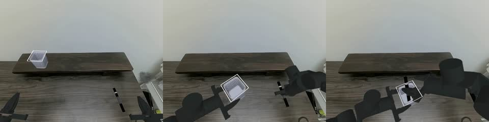

---
language:
- en
license: apache-2.0
library_name: lerobot
pipeline_tag: robotics
tags:
- OpenRAL
- rskill
- act
- lerobot
- vision-language-action
- makermods_metal_station
- rskill-kind:vla
- rskill-role:s1
- embodiment:makermods_metal_station
- rskill-license:apache-2.0
datasets:
- makermods/pen_holder_bi_20260723_161553
inference: false
openral:
  description: 'ACT (Action Chunking Transformer) by MakerMods for the two-arm MakerMods
    Metal Arm Station: the left arm lifts a pen holder off a shelf to mid-desk, the
    right arm drops a pen into it and the left arm puts the holder back, from a top
    and two wrist RGB views and the 14-D joint + gripper state, at 30 Hz in 100-step
    chunks of absolute joint positions (degrees in the checkpoint).'
  model_family: act
  min_vram_gb: 2.0
  latency_ms: 100.0
  runtime: pytorch
  dtype: fp32
---

# rskill-act-makermods_metal_station-pen_holder-fp32

> **OpenRAL rSkill** — MakerMods' [ACT](https://arxiv.org/abs/2304.13705) policy for the
> two-arm **MakerMods Metal Arm Station**: the left arm lifts a pen cup off a shelf, the
> right arm drops a marker into it. Trained on 41 real teleop episodes
> ([`makermods/pen_holder_bi_20260723_161553`](https://huggingface.co/datasets/makermods/pen_holder_bi_20260723_161553)).

This package points at
[`makermods/act_pen_holder_bi`](https://huggingface.co/makermods/act_pen_holder_bi)
(pinned `a4af0cc4`) and adds an `rskill.yaml`. The manifest declares the capability
contract, the degree and gripper-stroke units, the 30 Hz time base and the camera
aliases. It copies no weights.

## Preview

The MuJoCo twin `scenes/sim/makermods_metal_pen_holder.yaml` replays dataset episode 0
open loop: its recorded actions, from its own cup and pen start poses. The stills are the
top camera (real background plate, composited robot / cup / pen) at the start, at the pen
grasp (frame 250) and as the pen lands in the cup (frame 398, graded `complete`).



## What this skill does

The left arm lifts a white pen cup off a riser shelf and holds it at mid-desk. The right
arm picks a marker off the desk and drops it into the cup. The left arm then puts the cup
back on the shelf. The prompt is the training task string, `"Move the pen holder with the
left arm and put the pen into it with the right arm"`.

| Field | Value |
| --- | --- |
| Actions | `pick`, `place`, `insert` |
| Objects | `pen`, `pen_holder` |
| Scenes | `tabletop` |
| Embodiment | `makermods_metal_station` |

## How it works

This is lerobot 0.6.0 ACT:
- a ResNet-18 backbone per view;
- a 4-layer encoder and a 1-layer decoder;
- a 32-D VAE latent;
- about 51.6 M parameters (207 MB fp32).

Three 480 × 640 RGB views and the 14-D state go in. A 100-step chunk of absolute joint
positions comes out, and it is replayed in full before the next inference
(`n_action_steps` 100, no temporal ensembling). Normalisation is MEAN_STD on state,
images and action, done by the checkpoint's own `policy_preprocessor` /
`policy_postprocessor` (`processors` in the manifest).

### Observation → action contract

| Direction | Key | Shape | Notes |
| --- | --- | --- | --- |
| in | `observation.images.top` | `(1, 3, 480, 640)` | station top camera |
| in | `observation.images.left_wrist` | `(1, 3, 480, 640)` | the station's `wrist_left` (alias) |
| in | `observation.images.right_wrist` | `(1, 3, 480, 640)` | the station's `wrist_right` (alias) |
| in | `observation.state` | `(1, 14)` | left joint1..6 (**degrees**), left gripper stroke, then the right arm |
| out | action chunk | `(100, 14)` | absolute joints (degrees) + gripper strokes, same order |

**Units.** The dataset records joint1..6 in degrees, with the URDF's signs and zeros.
The gripper is recorded as a stroke: about 0 when closed and 102–108 when open. While
holding, the left gripper reads about 82 (on the holder) and the right about 22 (on the
pen). Two manifest fields make the codec convert in both directions:
- `action_contract.joint_units: degrees` converts radians ↔ degrees on the arms;
- `gripper_scale: 100` converts the normalised `[0 closed, 1 open]` gripper ↔ stroke.

A commanded stroke above 100 clamps to fully open. The `metal_pen_holder` scene converts
in-scene (`converts_policy_units`): joint8 = stroke / 2000 − 1.25 mm, the single-arm
twin's map, per arm.

**Pen grip.** The pen is 20 mm (`pen_diameter_m`; 55–57 px across in the right wrist
view, as the real one). Over the dataset's 40 right-hand holds the held stroke is p10 19.1 /
median 21.2 / p90 23.2 (max 25.6); the twin's rigid fingers settle at 22.2 on it and hold
up to a commanded 24. Where the policy drops the pen in the warm-start runs, it is
opening the gripper steadily (21 → 26 over ~20 steps): its release, fired away from the
cup, not a slip.

**Time base.** 30 Hz, the dataset's `fps`.

## Upstream model / training

| Field | Value |
| --- | --- |
| Source repo | [`makermods/act_pen_holder_bi`](https://huggingface.co/makermods/act_pen_holder_bi) @ `a4af0cc42618f935f1f7c8c5c717ad5769703745` |
| Base model | none (ImageNet ResNet-18 backbone init) |
| Paper | [arXiv:2304.13705](https://arxiv.org/abs/2304.13705) — *ACT* |
| License | apache-2.0 |
| Parameters | ~51.6 M |
| Training | lerobot 0.6.0, 20 000 steps, batch 16, seed 1000 (`train_config.json`) |
| Training data | [`makermods/pen_holder_bi_20260723_161553`](https://huggingface.co/datasets/makermods/pen_holder_bi_20260723_161553) @ `f9f3d995`: 41 episodes, 25 987 frames, 30 FPS, `robot_type: bi_metal_follower`, Apache-2.0 |

## Supported robots

| Robot | Embodiment tag | Status | Notes |
| --- | --- | --- | --- |
| MakerMods Metal Arm Station (2 × 6 joints + parallel gripper) | `makermods_metal_station` | ⚡ experimental | Sim only (MuJoCo twin `metal_pen_holder`). No real HAL exists yet. The station's arm spacing and top camera are fits of the dataset video. |

## Sensors required

| Key | Modality | Min resolution | Format |
| --- | --- | --- | --- |
| `observation.images.top` | RGB | 640 × 480 | `uint8` HWC |
| `observation.images.wrist_left` | RGB | 640 × 480 | `uint8` HWC |
| `observation.images.wrist_right` | RGB | 640 × 480 | `uint8` HWC |
| `observation.state` | proprioception | `(14,)` | `float32` |

`image_preprocessing.aliases` renames the slots `wrist_left` / `wrist_right` to the
checkpoint's `left_wrist` / `right_wrist`.

## Manifest summary

| Field | Value |
| --- | --- |
| `name` | `OpenRAL/rskill-act-makermods_metal_station-pen_holder-fp32` |
| `version` | `0.1.0` |
| `license` | `apache-2.0` |
| `role` | `s1` |
| `embodiment_tags` | `makermods_metal_station` |
| `runtime` / `quantization.dtype` | `pytorch` / `fp32` |
| `weights_uri` | `hf://makermods/act_pen_holder_bi@a4af0cc4…` (pinned) |
| `chunk_size` / `n_action_steps` | 100 / 100 |
| `action_contract` | dim 14, `joint_positions`, degrees, `gripper_scale` 100, 30 Hz |
| `starting_pose` | median first frame of the dataset; right joint2 sits 1 mrad inside its limit |
| `latency_budget.per_chunk_ms` | 100 |
| `is_commercial_use_allowed` | yes (Apache-2.0 weights and data) |

## Quick start

```bash
openral sim run --config scenes/sim/makermods_metal_pen_holder.yaml \
  --rskill rskills/act-pen-holder-bi --save-video out/ --video-style world
openral benchmark run --suite makermods_metal_pen_holder --rskill rskills/act-pen-holder-bi
```

## Reproduction

```bash
uv run pytest tests/unit/test_metal_pen_holder_options.py
uv run pytest tests/sim/test_makermods_metal_station_hal_metal_pen_holder.py
```

The unit test covers the manifest and its units, the scene options, the cup-interior
grading and the 10-layout suite. The sim test renders the three cameras and replays
dataset episodes 0, 7 and 30 open loop (fixture `tests/unit/fixtures/
metal_pen_holder_episodes.npz`): the left arm lifts the cup, the right arm drops the pen
in, graded `complete`.

## Evaluation

MuJoCo twin, local RTX 5070 Laptop and q5090, 2026-11-07.

- **Open-loop dataset replay:** 7 of 8 episodes (0, 1, 2, 3, 7, 10, 30; 25 `semi`) end
  `complete` from their own start layout (v2 layouts: cup centre 0.102 m along the left
  gripper axis, pen centre at the midpoint of its back-projected ends; the shelf front at
  x 0.402). This validates kinematics, units, the gripper map and the object physics.
- **Wiring on real frames:** real dataset observations through the composed `sim run`
  path give 1.3–1.5° joint MAE over the first 10 predicted steps (2.5–5° over 100)
  against the recorded actions, at 4 episodes × 6 ticks.
- **Benchmark, 30 episodes** (`benchmarks/makermods_metal_pen_holder.yaml`, 10 layouts ×
  seeds 0–2, 900 steps, q5090, 2026-11-08): **30 `fail`** (`eval/makermods_metal_pen_holder.json`,
  per-episode grades in `eval/episodes/`). From the start the policy never grasps.
- **Warm starts** (dataset replay to a handover, then the policy): from H1 (cup lifted)
  it grasps and lifts the pen by itself but releases it beside the cup; from H2/H3 it
  keeps both holds and releases the pen outside the cup (`semi`); the arms never converge.
- **Closed loop, 6 episodes (layouts P00, P03, P05, P00 twice more after the wrist
  round, P03): all `fail`.** The left arm swings to 0.11 m of the cup (finger midpoint to
  the cup's axis) and parks beside it half open; the right arm hovers 0.17–0.20 m above
  the pen; nothing is grasped (0 steps) or lifted (≤ 2 mm).

### Honest scope: this real-data checkpoint does not transfer to the sim twin

The policy is not miswired: on real frames it tracks the recorded actions. It fails on
the twin's rendered images. With the scene posed to the recorded state (4 episodes; mean
joint MAE over the first 10 / 100 predicted steps):

| Images | t = 0 | t = 100 (reach) | t = 180 (grasp) |
| --- | --- | --- | --- |
| all real | 1.50° / 5.0° | 1.38° / 3.3° | 1.50° / 3.9° |
| sim top only | 5.42° / 6.8° | 2.58° / 4.0° | 1.50° / 3.8° |
| sim left wrist only | 1.50° / 5.3° | 1.79° / 3.6° | 2.87° / 6.3° |
| sim right wrist only | 1.30° / 4.6° | 2.58° / 3.9° | 3.31° / 5.0° |
| all sim | 7.21° / 10.2° | 5.22° / 8.1° | 5.28° / 9.5° |

No single camera or object explains it: real frames with only the sim arm, cup or pen
pasted into the top view stay at 1.2–2.1° at t = 0, and region colour means match the real
frames to within ~10 % (top) and ~15 % (wrists). Rounds that did not move these numbers:
a hex-perforated rounded cup, a glossy marker, matched arm colour and finish, desk edge and
drawer unit for the right wrist, image blur, and per-wrist camera extrinsics fitted to the
real frames (edge correlation left 0.59 → 0.77, right 0.56 → 0.64). Open questions: the
right wrist sees the pen ~2× larger at mid-reach than the posed twin, and the pen pose that
fits the wrist frames sits 2–3.5 cm further forward than the top-camera estimate; the v2
layouts now use it (pen centre = midpoint of its back-projected ends), with the shelf front
moved back so the replays still pass. Treat any sim score of this checkpoint as a
sim-to-real-gap measurement, not a capability claim.

**What is left: the cup in the left wrist.** After the desk, pen-label, pen-size and layout
fixes the all-sim first-action error is 1.65° at H1 (all real 0.94°) but still 5.0° at H2,
the moment both arms hold their objects, against 2.5° with the real left wrist. Attempts that
left it unchanged: the cup's fitted in-hand pose, a deeper grasp, a taller cup (10.5-12.5 cm),
alpha-cut holes (MuJoCo ignores texture alpha), and holes cut through the walls as geometry
with the one solid wall the real cup has (`holder_hole_grid`, `holder_solid_side`; now the
default look). A left-arm joint + camera refit to the real frames moved it to 4.45°, and the
pre-grasp camera refit (1.5-2.6 cm, ~2°) did not lower the error averaged over five ticks
(3.0° → 3.1°). Pasting real patches into the sim view puts the gain on the left half of the
real image (desk and shelf edge seen past the cup: 4.9° → 2.7°), not its centre (5.1°): the
real camera sees the cup side-on and farther away, which no single cup or camera parameter
reproduced.

**What it is not.** Measured on q5090 (MuJoCo warm starts and perturbed replays, 2026-11-08):
- *Execution mode.* The adapter's default temporal ensembling (coeff 0.01) and the
  checkpoint's own 100-step chunks both carry the pen and release it beside the cup (9/9
  handovers each); 10/25-step chunks and newest-weighted ensembling hold it beside the cup and
  never release. RTC does not apply (ACT is not a flow-matching policy).
- *Physics.* Replays tolerate about ±1 cm of aim error: a 1.6 cm left-arm miss pushes the cup
  away (0/8), as the 13 mm per-side finger clearance predicts. Friction ×2, cup mass 20/150 g
  and finger stiffness ×0.27/×3.3 do not widen that, and the sim joints track the real ones
  within 0.35° (1-2 frame lag).
- *Arm spacing.* Over all 39 replayable episodes the measured 0.612 m spacing places the most
  pens (32/39); the 0.584 m kinematic estimate places 8/39. Moving the right base 1.4 cm
  forward gives 34/39 and centres the pen in the grip (bias 0.95 ± 0.18 cm → -0.44 cm), a
  candidate refinement not applied here.

So the checkpoint's sim misses come from aim errors above ~1 cm driven by what its wrist
cameras see; any sim score of it is a sim-to-real-gap measurement.

## License

- **Code:** this package is Apache-2.0; lerobot is Apache-2.0.
- **Weights:** Apache-2.0 (`makermods/act_pen_holder_bi`). The training dataset is
  Apache-2.0.

## See also

- [`robots/makermods_metal_station`](../../robots/makermods_metal_station/) — the robot.
- [`rskills/pi05-metal-pick-place`](../pi05-metal-pick-place/) — the single-arm Metal checkpoint, same units.
- [`rskills/act-aloha`](../act-aloha/) — ACT on another bimanual embodiment.
