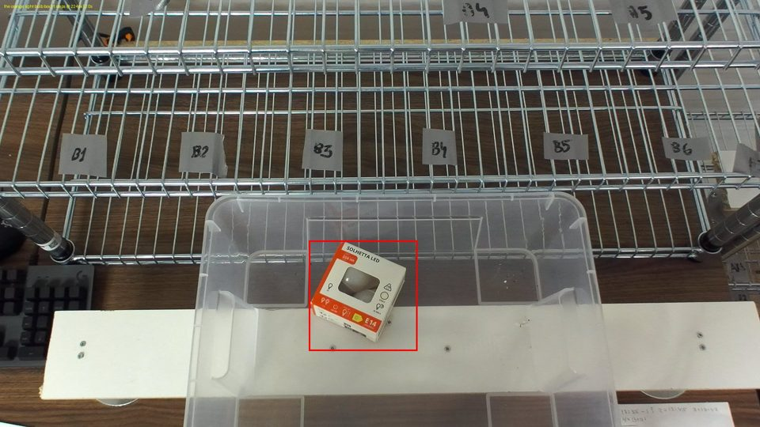
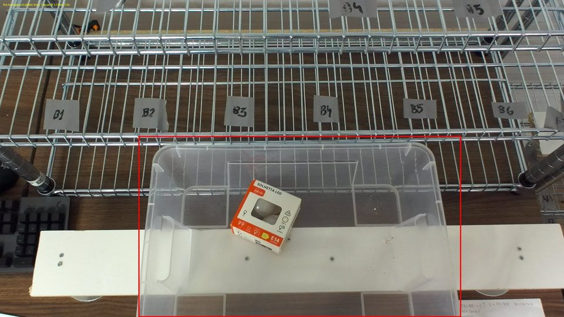

---
language:
- en
license: other
license_name: flux-non-commercial-license
pipeline_tag: object-detection
tags:
- OpenRAL
- rskill
- detector
- object-detection
- any
- rskill-kind:detector
- rskill-role:s1
- embodiment:any
- rskill-license:flux_non_commercial
inference: false
openral:
  description: Open Vision Banana 4B (zero-shot) — FLUX.2 [klein] fine-tuned to paint
    perception answers — packaged as an on-demand referring-segmentation locator.
    Given an RGB frame and a free-text description it paints the matching region,
    which is decoded into one box per connected region. No actuators.
  model_family: null
  min_vram_gb: 17.0
  latency_ms: 5000.0
  runtime: pytorch
  dtype: bf16
---

# rskill-open_vision_banana_4b-any-refseg-bf16

> **OpenRAL rSkill** — [Open Vision Banana](https://openvisionbanana.github.io/)
> 4B zero-shot (FLUX.2 [klein] fine-tuned to paint perception answers),
> packaged as an **on-demand referring-segmentation locator**. Perception only.
> **No actuators.** The upstream weights are under the **FLUX Non-Commercial
> License**.

## Preview

Real output at the default (1 step, 224 px) on a live ZED-M frame of a restock
shelf, from the Jetson AGX Orin measurement run (2026-11-17). Red = the box
OpenRAL decoded from OVB's painted mask; the caption is query, setting and
end-to-end latency.

| "the orange light bulb box" | "the transparent plastic bin" |
| --- | --- |
|  |  |

## Quick Start

The model runs in its own sidecar venv (`diffusers==0.39.0`,
`transformers==4.57.6`), built on first use by `tools/ovb_sidecar.py`. The
detector node only needs the ZMQ wire:

```bash
just sync --group ovb
OPENRAL_ALLOW_NONCOMMERCIAL=1 openral deploy sim --config scenes/deploy/<scene>.yaml \
  --object-detector-locator open-vision-banana-4b
```

The reasoner then reaches it through `locate_in_view` with `detector:
open-vision-banana-4b`; its query is used as the referring expression.

## Upstream model / training

- **Model:** Open Vision Banana 4B zero-shot, checkpoint
  `final_models/4B/zeroshot/checkpoint-87500-95000-w25/transformer` of
  [`FunAILab/Open-Vision-Banana`](https://huggingface.co/FunAILab/Open-Vision-Banana)
  @ `be5da66`.
- **Architecture:** a fine-tuned FLUX.2 [klein] transformer loaded into the
  base [`black-forest-labs/FLUX.2-klein-base-4B`](https://huggingface.co/black-forest-labs/FLUX.2-klein-base-4B)
  pipeline @ `a3b4f48` (Qwen3 text encoder, VAE, scheduler).
- **Training:** public data only; the zero-shot mix excludes the evaluation
  benchmarks' training splits. Code: [OpenVisionBanana/OpenVisionBanana](https://github.com/OpenVisionBanana/OpenVisionBanana).

## Supported robots / embodiments

Any (`embodiment_tags: [any]`): a perception rSkill that needs only an RGB
camera and commands no actuators.

## Sensors / observation contract

One RGB frame, at least 256 × 256. The frame's longest edge is capped at
224 px before generation; boxes are reported in the frame's own pixel space.

## Manifest summary

| Field | Value |
| --- | --- |
| `kind` / `role` | `detector` / `s1` |
| `detector.engine` / `mode` | `ovb_sidecar` / `on_demand` |
| `runtime` / dtype | `pytorch` / `bf16` |
| `license` | `flux_non_commercial` |
| `detector.max_side` / `ovb.num_inference_steps` | 224 / 1 |
| `latency_budget.per_chunk_ms` | 5000 (measured median 2.04 s on Jetson AGX Orin) |

## How it answers

1. The query becomes OVB's upstream referring-segmentation prompt
   (`[TASK: REFERRING_SEGMENTATION] … Paint the matching region red [220, 30, 30] …`).
2. The sidecar runs **1** denoising step (guidance 3.5, seed 0) on the frame
   with its longest edge capped at **224 px**, and returns the painted image.
   Upstream's default is 28 steps at ~1 MP; see Performance for the trade.
3. The detector node snaps each painted pixel to the nearer of the paint colour
   or black (upstream's evaluation rule), finds 4-connected regions larger than
   0.1 % of the image at the painted resolution, and scales each region's box
   to the frame.

Every box carries `confidence=1.0`: OVB emits no score.

## Performance

Measured 2026-11-17 on a Jetson AGX Orin (64 GB, JetPack R39, sidecar
`--offload none`, bf16), live ZED-M 1920 × 1080 frames, four queries on a
restock shelf scene (orange light-bulb box, transparent bin, keyboard, shelf
label "B3"). Latency is end to end through `OpenVisionBananaDetector`.

| Steps | Max side | Median / query | Bulb box | Bin | Keyboard | Label "B3" |
| --- | --- | --- | --- | --- | --- | --- |
| 28 | 1024 | 200.8 s | ✓ | ✓ | ✓ | ✗ (B2) |
| 28 | 512 | 64.3 s | ✓ | ✓ | ✓ | ✗ (B2) |
| 8 | 512 | 19.6 s | ✓ | ✓ | ✓ | ✗ (B2) |
| 4 | 512 | 10.6 s | ✓ | ✓ | ✓ | ✗ (B2) |
| 2 | 224 | 3.3 s | ✗ | ✓ | ✗ | ✗ |
| **1** | **224** | **2.04 s** | ✓ (loose) | ✓ | ✓ (loose) | ✗ (none) |

Rows other than the default were measured before regions were labelled at
the painted resolution, so they include ~0.4 s (2.4 s for the large bin) of
region search the current code no longer spends. The default row is 12
queries with the current code (2.00–2.09 s). Model load: 11–13 s, 16.0 GB. Latency scales with steps × pixels; the default
trades box tightness for speed. It does not read handwritten text at any
setting.

## Limits

- **On-demand only.** One query is a diffusion run — seconds, not
  milliseconds — so it is never the continuous detector.
- **Memory.** ~16 GB of bf16 weights (transformer 7.75 GB + Qwen3 text encoder
  8.0 GB). `tools/ovb_sidecar.py --offload none` on unified-memory Jetsons;
  the default `model` offload suits discrete GPUs under 17 GB.
- **Offline robots.** The sidecar resolves both pinned snapshots with
  `snapshot_download` and loads from disk, so it starts with
  `HF_HUB_OFFLINE=1` once the weights are cached (verified on the Orin run).
  It fetches only the OVB transformer subfolder and the base pipeline's
  text encoder, tokenizer, VAE and scheduler (~24 GB), never the base
  transformer.
- **Depth is not used.** OVB's depth output is relative inverse depth, never
  metric; this rSkill runs only the referring-segmentation task.

## License

- **Code:** Apache-2.0 (OpenRAL and upstream OVB).
- **Weights:** FLUX Non-Commercial License (`flux_non_commercial`). The loader
  refuses a commercial deployment unless `OPENRAL_ALLOW_NONCOMMERCIAL=1`.

## Citation

Open Vision Banana: A Fully Open Recipe for Generative Visual Perception,
arXiv:2611.15844.
