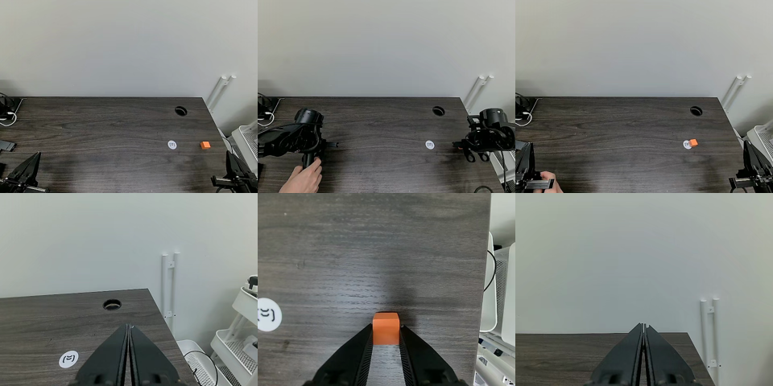

---
language:
- en
license: other
license_name: permissive-research
library_name: lerobot
pipeline_tag: robotics
tags:
- OpenRAL
- rskill
- pi05
- lerobot
- vision-language-action
- makermods_metal
- rskill-kind:vla
- rskill-role:s1
- embodiment:makermods_metal
- rskill-license:permissive_research
- lora
base_model:
- lerobot/pi05_base
base_model_relation: adapter
datasets:
- HappyEthan/metal_pick_place
inference: false
openral:
  description: 'π0.5 with MakerMods'' LoRA for the MakerMods Metal arm: picks a cube
    and places it on a marked spot from a fixed table-facing and a wrist RGB view
    and the 7-D joint + gripper state, at 30 Hz in 50-step chunks of absolute joint
    positions (degrees in the checkpoint). The LoRA is merged into lerobot/pi05_base
    at load. PI permissive-research base weights: commercial use needs a vendor agreement.'
  model_family: pi05
  min_vram_gb: 9.5
  latency_ms: 500.0
  runtime: pytorch
  dtype: bf16
---

# rskill-pi05-makermods_metal-pick_place-bf16

> **OpenRAL rSkill** — Physical Intelligence's [π0.5](https://arxiv.org/abs/2504.16054)
> base with MakerMods' LoRA for the **MakerMods Metal** arm: pick up a cube and place
> it at a marked spot, trained on 100 real teleop episodes
> ([`HappyEthan/metal_pick_place`](https://huggingface.co/datasets/HappyEthan/metal_pick_place)).

This package points at the LoRA
[`makermods/pi05_metal_pick_place_lora`](https://huggingface.co/makermods/pi05_metal_pick_place_lora)
(pinned `87595e59`) and its base
[`lerobot/pi05_base`](https://huggingface.co/lerobot/pi05_base) (pinned `22c30e5b`),
and adds an `rskill.yaml`: capability checking, the degree and
gripper-stroke units, the 30 Hz time base, and `base_weights_uri`, which makes the
π0.5 adapter merge the LoRA into the base at load. It copies no weights.

## Preview

Training data, episode 0 at 1 s, 15 s and 28.7 s: the `top` view (a fixed camera
facing the arm across the table; the leader arm is in frame too) above the `wrist`
view.



## What this skill does

Picks a small cube off the tabletop and places it on a marked spot, prompted with
the training task string `"Pick up the cube and place it at the marked location"`.

| Field | Value |
| --- | --- |
| Actions | `pick`, `place`, `pick_and_place` |
| Objects | `cube` |
| Scenes | `tabletop` |
| Embodiment | `makermods_metal` |

## How it works

π0.5 (PaliGemma 3B + a flow-matching action expert, 10 denoising steps). Two RGB
views (resized with padding to 224 × 224 by lerobot) and the 7-D state go in; a
50-step chunk of absolute joint positions comes out and is replayed in full before
the next inference.

**LoRA merge.** The adapter repo holds `adapter_config.json` (plain LoRA, r = 16,
`lora_alpha` = 32, peft 0.19.1) and 152 `lora_A` / `lora_B` tensors on 76 Linear
layers: `q_proj` / `v_proj` of every PaliGemma language layer and every
action-expert layer, plus `action_in_proj`, `action_out_proj`, `time_mlp_in` and
`time_mlp_out`. The pi05 adapter streams the base weights, then
`openral_sim.policies._lora` folds each pair in, `W += 2.0 · B @ A`, in fp32 with
one cast back to bf16 (logged `lora.merged`: 76 modules, 3 195 904 LoRA parameters,
largest relative weight change 5.2 %). Anything but plain LoRA, any key that does
not land on a targeted Linear weight, and a base other than `lerobot/pi05_base`
are refused. No `peft` dependency; the merged model runs exactly like a dense π0.5.

### Observation → action contract

From the LoRA repo's `config.json` and processors:

| Direction | Key | Shape | Notes |
| --- | --- | --- | --- |
| in | `observation.images.top` | `(1, 3, 480, 640)` | static rig camera |
| in | `observation.images.wrist` | `(1, 3, 480, 640)` | gripper camera |
| in | `observation.state` | `(1, 7)` | joint1..6 in **degrees** + gripper stroke |
| in | `task` | str | `"Pick up the cube and place it at the marked location"` |
| out | action chunk | `(50, 7)` | absolute joint1..6 (degrees) + gripper stroke |

**Units.** The dataset records joint1..6 in degrees with the URDF's signs and zeros
(joint2 spans −120° … 0.4°, joint3 −0.8° … 82°) and the gripper as a stroke of
0 … 125 (about 100 open, 2.5 closed). `action_contract.joint_units: degrees` and
`gripper_scale: 100` make the codec convert radians ↔ degrees on the arm and the
normalised `[0 closed, 1 open]` gripper ↔ stroke, in both directions; a stroke
above 100 clamps to fully open. Normalisation is QUANTILES (state and action).

**Time base.** 30 Hz (dataset `fps`); `chunk_size` = `n_action_steps` = 50.

## Upstream model / training

| Field | Value |
| --- | --- |
| Adapter | [`makermods/pi05_metal_pick_place_lora`](https://huggingface.co/makermods/pi05_metal_pick_place_lora) @ `87595e59df01dc78e794b41df756241cb5efd7b6` (12.8 MB) |
| Base | [`lerobot/pi05_base`](https://huggingface.co/lerobot/pi05_base) @ `22c30e5b34f9e7ab738b1b34fc2fc5ecfe2d28f0` (14.5 GB fp32) |
| Training | lerobot, 30 000 steps, batch 1, AdamW 2.5e-5, LoRA r = 16 / α = 32 (`train_config.json`) |
| Dataset | [`HappyEthan/metal_pick_place`](https://huggingface.co/datasets/HappyEthan/metal_pick_place) @ `aaf1afcc`: 100 episodes, 76 865 frames, 30 FPS, `robot_type: metal_follower`, Apache-2.0 |
| Paper | [arXiv:2504.16054](https://arxiv.org/abs/2504.16054) — *π0.5* |

## Supported robots

| Robot | Embodiment tag | Status | Notes |
| --- | --- | --- | --- |
| MakerMods Metal (6 joints + parallel gripper) | `makermods_metal` | ⚡ experimental | Open-loop replay on the training data only; the robot's camera placements are fits of the dataset video, not measured mounts. No real HAL exists yet. |

## Sensors required

| Key | Modality | Min resolution | Format |
| --- | --- | --- | --- |
| `observation.images.top` | RGB | 224 × 224 (trained at 640 × 480) | `uint8` HWC |
| `observation.images.wrist` | RGB | 224 × 224 (trained at 640 × 480) | `uint8` HWC |
| `observation.state` | proprioception | `(7,)` | `float32` |

## Manifest summary

| Field | Value |
| --- | --- |
| `name` | `OpenRAL/rskill-pi05-makermods_metal-pick_place-bf16` |
| `version` | `0.1.0` |
| `license` | `permissive_research` |
| `model_family` | `pi05` |
| `weights_uri` / `base_weights_uri` | the LoRA / `lerobot/pi05_base`, both pinned |
| `quantization` | `bf16` / `pytorch` (8.8 GiB peak measured; `min_vram_gb` 9.5) |
| `chunk_size` / `n_action_steps` | 50 / 50 |
| `action_contract` | dim 7, `joint_positions`, degrees, `gripper_scale` 100, 30 Hz |
| `starting_pose` | dataset median first frame; joint2 / joint3 1 mrad inside their limits |

## Quick start

```bash
# A CUDA device with >= 10 GiB free; downloads the 14.5 GB base on first use.
uv run python - <<'PY'
from types import SimpleNamespace
import numpy as np
from openral_core import VLASpec
from openral_sim.policies.pi05 import _build_pi05

spec = VLASpec(id="pi05", weights_uri="rskills/pi05-metal-pick-place", device="cuda:0",
               extra={"camera_keys": ["top", "wrist"]})
policy = _build_pi05(SimpleNamespace(vla=spec, scene=None))
obs = {"images": {k: np.zeros((480, 640, 3), np.uint8) for k in ("top", "wrist")},
       "state": np.array([0.7, 0.0, 0.0, 0.5, -0.1, -1.4, 2.5], np.float32)}  # degrees, stroke
print(policy.step(obs, "Pick up the cube and place it at the marked location"))
PY
```

## Reproduction

```bash
uv run pytest -s tests/sim/test_makermods_metal_pi05_dataset_replay.py
```

Ten recorded frames (episodes 0 and 1, every 4 s from 1 s) go through the codec and
the adapter's `step`; the first 10 actions of each chunk are compared with the
recorded ones, then the LoRA delta is subtracted from the same weights and the base
alone runs the same frames.

## Evaluation

Open loop on training data (Spark, NVIDIA GB10, bf16, 2026-11-07); mean absolute
error over the first 10 actions of 10 chunks:

| Weights | Joint MAE (°) | Per joint (°) | Gripper MAE (stroke) |
| --- | --- | --- | --- |
| base + LoRA | **1.12** | 0.49, 1.78, 1.38, 1.40, 0.34, 1.31 | **3.4** |
| base only | 10.12 | 9.06, 30.09, 11.15, 6.20, 1.62, 2.61 | 10.5 |

Load 7.8 s from a warm cache (base stream 3.2 s, merge 0.2 s), 8.8 GiB peak device
memory, 191 ms median per 50-step chunk (805 ms first call). This is a wiring check,
not a success rate: no closed-loop result exists yet, so `eval/` is empty.

## License

- **Code:** this package Apache-2.0; openpi / lerobot Apache-2.0.
- **Weights:** `permissive_research`. The LoRA and the dataset are Apache-2.0, but the
  merged policy is built on Physical Intelligence's π0.5 base, which OpenRAL treats as
  permissive research (CLAUDE.md §3). Commercial use needs an agreement with
  Physical Intelligence.

## See also

- [`robots/makermods_metal`](../../robots/makermods_metal/) — the robot.
- [`rskills/pi05-droid-jointpos-arena`](../pi05-droid-jointpos-arena/) — the same π0.5 graph on DROID.
- [`rskills/rskill-smolvla-so101-eraser_place-bf16`](../rskill-smolvla-so101-eraser_place-bf16/) — another MakerMods checkpoint in degrees.
