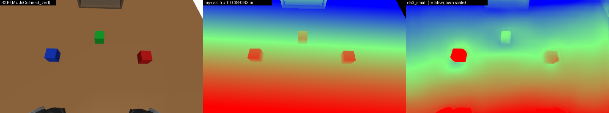

---
language:
- en
license: apache-2.0
pipeline_tag: depth-estimation
tags:
- OpenRAL
- rskill
- depth-estimator
- depth-estimation
- monocular-depth
- any
- rskill-kind:depth_estimator
- rskill-role:s1
- embodiment:any
- rskill-license:apache-2.0
inference: false
openral:
  description: Depth Anything 3 small packaged as a monocular depth estimator for
    mono visual SLAM. Estimates depth and its own camera intrinsics from one RGB frame,
    which cuVSLAM and nvblox fuse into pose and an occupancy grid on a lidar-less
    robot. Wraps depth-anything/DA3-SMALL. Not documented as metric, so it never feeds
    collision checking. Emits no actions and drives no actuators.
  model_family: null
  min_vram_gb: 0.6
  latency_ms: 200.0
  runtime: pytorch
  dtype: bf16
---

# rskill-da3_small-any-depth-bf16

> **OpenRAL rSkill**: Depth Anything 3 small packaged as a **monocular depth
> estimator** (`kind: depth_estimator`) for mono visual SLAM. One RGB frame in, a depth
> raster plus the model's own pinhole estimate out.

## Preview



RGB, ray-cast ground truth and this skill's relative depth (own colour range) on the MuJoCo OpenArm `head_zed` frame.

## What this skill does

With `DeployRuntime.slam_mono_camera` set, the deploy launch runs the depth provider in
its SLAM mode on that camera with this skill. Each reply carries depth and DA3's own
intrinsics (`predicts_intrinsics: true`); the provider publishes both, and cuVSLAM
(RGBD odometry, for scale) and nvblox (occupancy grid and voxels) fuse them. That is
what gives a lidar-less, camera-only robot a navigable `/map`.

DA3's main series is **not documented as metric** (`output: relative`), so the provider
refuses this skill in metric mode: it never feeds the world-collision map.

## How it runs

`runtime: pytorch` + `family: da3`: `tools/depth_estimator_sidecar.py` boots
`tools/da3_depth_sidecar.py` (isolated `depth-anything-3` venv) on port 5771 with the
model pinned by `weights_uri`. `DeployRuntime.slam_depth_sidecar_autostart: false`
leaves the sidecar to the operator.

## Measured numbers

Measured 2026-11-24 on an RTX 5070 Laptop (8 GB), 12 frames per size, `process_res` 504,
whole-process VRAM from `nvidia-smi`, latency = the server's inference time.

| Input | Model raster | Warm median | p90 | First call | VRAM |
|---|---|---|---|---|---|
| 640x480 | 504x378 | 74.7 ms | 145.2 ms | 1325 ms | 558 MiB |
| 1280x720 | 504x280 | 93.7 ms | 131.5 ms | 169 ms | 558 MiB |

An earlier RTX 4070 Laptop measurement put the model at 0.27 GB and ~27 Hz.

## Upstream model and training

[`depth-anything/DA3-SMALL`](https://huggingface.co/depth-anything/DA3-SMALL), pinned at
`e08cab65ca0ec38e7826075418411ab90cab4da3`. Depth Anything 3
([arXiv 2511.10647](https://arxiv.org/abs/2511.10647)). Weights unmodified.

## Supported robots

`embodiment_tags: ["any"]`: any robot with one RGB camera and the PyCuVSLAM visual SLAM
backend (`slam_visual_impl: pycuvslam`).

## Sensors required

One RGB stream, at least 320x240. No `CameraInfo` is needed: the model estimates its own.

## Manifest summary

| Field | Value |
|---|---|
| `kind` | `depth_estimator` (role `s1`) |
| `depth_estimator.family` / `output` | `da3` / `relative` |
| `depth_estimator.predicts_intrinsics` | `true` |
| `depth_estimator.process_res` | `504` |
| `runtime` / `quantization` | `pytorch` / `bf16` (fp32 weights, bf16 autocast) |
| `min_vram_gb.bf16` | `0.6` |
| `latency_budget.per_chunk_ms` | `200` |
| `license` | `apache-2.0` |

## Quick start

```bash
python tools/depth_estimator_sidecar.py \
  --manifest rskills/rskill-da3_small-any-depth-bf16/rskill.yaml --port 5771
```

## Known limitations

- Not metric: fine for SLAM scale through cuVSLAM, never for collision checking.
- The model's intrinsics are an estimate; nvblox places the depth through the HAL's
  camera TF.

## License

Weights and `depth-anything-3` code: Apache-2.0. OpenRAL packaging: Apache-2.0.

## See also

- [`rskill-da3metric_large-any-metric_depth-bf16`](../rskill-da3metric_large-any-metric_depth-bf16/) -
  the metric model for the world-collision map.
