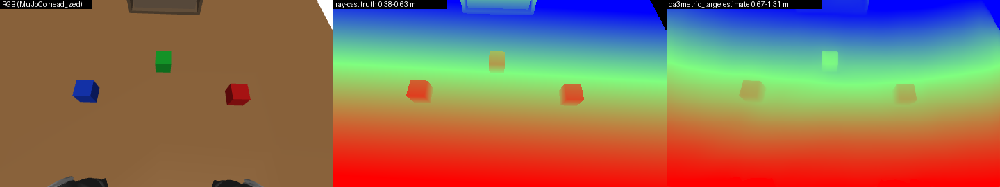

---
language:
- en
license: apache-2.0
pipeline_tag: depth-estimation
tags:
- OpenRAL
- rskill
- depth-estimator
- depth-estimation
- monocular-depth
- any
- rskill-kind:depth_estimator
- rskill-role:s1
- embodiment:any
- rskill-license:apache-2.0
inference: false
openral:
  description: Depth Anything 3 metric (large) packaged as a monocular depth estimator.
    Estimates canonical depth from one RGB frame; the depth provider turns it into
    metres with the camera's own calibrated focal and back-projects it into the world-collision
    cloud on a robot with no depth sensor. Wraps depth-anything/DA3METRIC-LARGE. An
    estimate, not a measurement. Emits no actions and drives no actuators.
  model_family: null
  min_vram_gb: 2.0
  latency_ms: 150.0
  runtime: pytorch
  dtype: bf16
---

# rskill-da3metric_large-any-metric_depth-bf16

> **OpenRAL rSkill**: Depth Anything 3 metric (large) packaged as a **monocular depth
> estimator** (`kind: depth_estimator`). One RGB frame in, one depth raster out. It is
> the default model behind `DeployRuntime.estimated_depth_camera`, which gives a robot
> with no depth sensor a world-collision cloud. The depth is an **estimate, not a
> measurement**.

## Preview



RGB, ray-cast ground truth and this skill's metres on the MuJoCo OpenArm `head_zed` frame, each panel on its own colour range. The shape matches; the scale reads about 2x too far on this untextured close-up (see Measured numbers).

## What this skill does

The depth provider (`openral_perception_ros/depth_provider_node.py`) sends each
rectified RGB frame to this skill's sidecar and gets back DA3METRIC's *canonical*
depth: depth at a fixed 300 px focal length. The provider turns it into metres with the
camera's own calibrated focal scaled to the model's processing raster:

```
metres = mean(fx, fy) * raw / 300      # DepthEstimatorContract.canonical_focal_px
```

then back-projects it (clipped at `max_range_m`) into
`/openral/cameras/<camera>/points`, which `octomap_server` maps. The robot self filter
always runs on that cloud, because the model sees the arm.

The camera's calibrated K is used, never a K the model guesses: the cloud is placed
through the camera's calibrated mount, so its scale has to come from the same lens.

## How it runs

`runtime: pytorch` + `depth_estimator.family: da3` select the in-tree sidecar:
`tools/depth_estimator_sidecar.py --manifest <this rskill.yaml>` applies the license
gate and boots `tools/da3_depth_sidecar.py`, which provisions an isolated Python 3.12
venv with the `depth-anything-3` package (not transformers-native) and serves the model
pinned by `weights_uri` over ZMQ REQ/REP + msgpack. The deploy launch starts it on port
5772 whenever `estimated_depth_camera` is set.

## Measured numbers

Measured 2026-11-24 on an RTX 5070 Laptop (8 GB), 12 frames per size, `process_res` 504.
VRAM is the whole sidecar process (CUDA context included), read from `nvidia-smi`;
latency is the server's own inference time.

| Input | Model raster | Warm median | p90 | First call | VRAM |
|---|---|---|---|---|---|
| 640x480 | 504x378 | 75.9 ms | 107.5 ms | 927 ms | 1988 MiB |
| 1280x720 | 504x280 | 63.6 ms | 72.3 ms | 125 ms | 1988 MiB |

Accuracy against simulator ground truth:

- **Isaac Sim `head_zed`** (Spark, 2026-10-14, recorded in `metric_depth.py`): median
  estimate/ground-truth ratio 0.94-1.16 across `process_res` 252-1008 with the focal
  taken at the model's raster; abs-rel 0.13-0.16 at `process_res` 504; the robot's own
  arm at 0.2-0.45 m read about 0.1 m too far.
- **MuJoCo OpenArm `head_zed`** (2026-11-24,
  `tests/sim/test_openarm_hal_mujoco_depth_estimator.py`): median ratio **1.95**. That
  frame is a 480x270 render of an untextured table 0.4-0.6 m away, well outside the
  model's training distribution. The test keeps it as a strict xfail so a fix shows up.

## Upstream model and training

[`depth-anything/DA3METRIC-LARGE`](https://huggingface.co/depth-anything/DA3METRIC-LARGE),
pinned at revision `4010e39f3634a45bc60553321fb49fb760bd594e`. Depth Anything 3
([arXiv 2511.10647](https://arxiv.org/abs/2511.10647)); the metric series predicts
canonical depth from a single view. OpenRAL did not retrain or modify the weights.

## Supported robots

`embodiment_tags: ["any"]`. Any robot with an RGB camera that has calibrated
intrinsics and a declared mount (`openral_core.depth_extrinsic.resolve_estimated_depth_camera`).
The launch refuses it on a robot or scene that has any measured depth or point-cloud
sensor: an estimate never replaces a measurement.

## Sensors required

One RGB stream (at least 320x240) and its `CameraInfo`. The provider rectifies the frame
to an exact pinhole with that `CameraInfo`'s lens model before inference.

## Manifest summary

| Field | Value |
|---|---|
| `kind` | `depth_estimator` (role `s1`) |
| `depth_estimator.family` | `da3` |
| `depth_estimator.output` | `canonical_focal` (`canonical_focal_px: 300`) |
| `depth_estimator.process_res` | `504` |
| `runtime` / `quantization` | `pytorch` / `bf16` (fp32 weights, bf16 autocast) |
| `min_vram_gb.bf16` | `2.0` |
| `latency_budget.per_chunk_ms` | `150` |
| `license` | `apache-2.0` |

## Quick start

```yaml
# scenes/deploy/<your scene>.yaml
runtime:
  estimated_depth_camera: top_camera
  # estimated_depth_rskill defaults to this skill
```

or by hand:

```bash
python tools/depth_estimator_sidecar.py \
  --manifest rskills/rskill-da3metric_large-any-metric_depth-bf16/rskill.yaml --port 5772
```

## Known limitations

- An estimate: glass, low texture and far range can be misplaced or missed, and the cloud
  reaches the safety kernel's world voxels. The launch logs that at WARN.
- The first call takes about 1 s (CUDA warm-up); the provider publishes nothing until the
  sidecar answers, so the kernel's world-voxel deadline stops motion meanwhile.

## License

Weights and the `depth-anything-3` code: Apache-2.0. The OpenRAL packaging (this
manifest, the sidecar launcher and the provider) is Apache-2.0.

## See also

- [`rskill-da3_small-any-depth-bf16`](../rskill-da3_small-any-depth-bf16/) - the mono
  visual-SLAM depth source.
- [`rskill-depth_pro2_s-any-metric_depth-bf16`](../rskill-depth_pro2_s-any-metric_depth-bf16/) -
  Apple Depth Pro 2, a research-only alternative for the same slot.
