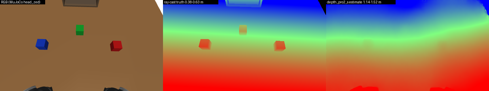

---
language:
- en
license: other
license_name: apple-amlr
pipeline_tag: depth-estimation
tags:
- OpenRAL
- rskill
- depth-estimator
- depth-estimation
- monocular-depth
- any
- rskill-kind:depth_estimator
- rskill-role:s1
- embodiment:any
- rskill-license:apple-amlr
inference: false
openral:
  description: Apple Depth Pro 2 (S, 24M parameters) packaged as a monocular metric
    depth estimator. Given the camera's calibrated focal length it returns metres
    per pixel at the input's own resolution, which the depth provider back-projects
    into the world-collision cloud on a robot with no depth sensor. Wraps apple/DepthPro2-S.
    Research-only weights (Apple ML Research Model license). An estimate, not a measurement.
    Emits no actions and drives no actuators.
  model_family: null
  min_vram_gb: 1.2
  latency_ms: 60.0
  runtime: pytorch
  dtype: bf16
---

# rskill-depth_pro2_s-any-metric_depth-bf16

> **OpenRAL rSkill**: Apple Depth Pro 2 (S, 24M parameters) packaged as a **monocular
> metric depth estimator** (`kind: depth_estimator`). Given the camera's focal length in
> pixels it returns metres at the input's own resolution. **Research use only**: the
> weights are under the Apple Machine Learning Research Model license.

## Preview



RGB, ray-cast ground truth and this skill's metres on the MuJoCo OpenArm `head_zed` frame (`f_px` 240), each panel on its own colour range. The scale reads about 2.7x too far on this untextured close-up (see Measured numbers).

## What this skill does

A drop-in alternative to DA3METRIC for `DeployRuntime.estimated_depth_camera`:

```yaml
runtime:
  estimated_depth_camera: top_camera
  estimated_depth_rskill: rskill-depth_pro2_s-any-metric_depth-bf16
```

The depth provider rectifies each frame to a pinhole with the camera's `CameraInfo` and
sends it with that pinhole's `fx` as `f_px` (`output: metric`). The checkpoint has no
field-of-view head (`config.json`: `fov: false`), so it never guesses a focal: depth
scales with the focal length, and the cloud must scale with the real lens. Each frame is
inferred on its own (`DepthPro2.infer`), not as a video clip, so the provider never
waits for future frames.

## How it runs

`runtime: pytorch` + `family: depth_pro2`: `tools/depth_estimator_sidecar.py` applies
the license gate, then boots `tools/depth_pro2_sidecar.py`, which installs the
`depth_pro_2` package from
[apple-aiml-research/ml-depth-pro-2](https://github.com/apple-aiml-research/ml-depth-pro-2)
at pinned commit `aa389cbb0b74341664ed663a0966c859905cd6c0` into an isolated venv and
serves `apple/DepthPro2-S` (pinned by `weights_uri`) with the DA3 sidecar's wire
protocol (`tools/_depth_pro2_server.py`). It runs under bfloat16 autocast, the upstream
default on CUDA.

## Measured numbers

Measured 2026-11-24 on an RTX 5070 Laptop (8 GB), 12 frames per size, whole-process
VRAM from `nvidia-smi`, latency = the server's inference time. Memory grows with the
frame because the model runs at the input's native resolution.

| Input | Warm median | p90 | First call | VRAM |
|---|---|---|---|---|
| 640x480 | 13.5 ms | 18.7 ms | 698 ms | 560 MiB |
| 1280x720 | 33.0 ms | 35.1 ms | 51 ms | 1140 MiB |

Accuracy against simulator ground truth, MuJoCo OpenArm `head_zed`
(`tests/sim/test_openarm_hal_mujoco_depth_estimator.py`, 2026-11-24): median
estimate/ray-cast ratio **2.70** at the native 480x270, and 3.80 / 1.30 when the same
frame is upscaled 2x / 4x. That frame is an untextured table 0.4-0.6 m away, out of the
model's distribution, and the swing with input size matches upstream's warning that
resizing can shift the depth scale. No in-distribution ground-truth measurement exists
yet; do not rely on this skill for collision checking until one does.

## Upstream model and training

[`apple/DepthPro2-S`](https://huggingface.co/apple/DepthPro2-S), pinned at
`903a1c1ade918831d138adcc4aedbcc8f4da0078`: a DINOv3 ViT-S backbone with a DPT decoder.
Depth Pro 2 ([arXiv 2611.26603](https://arxiv.org/abs/2611.26603)). Weights unmodified
and pulled from Apple's repository, never re-hosted.

## Supported robots

`embodiment_tags: ["any"]`: any robot whose RGB camera has calibrated intrinsics and a
declared mount, under the same rules as the DA3METRIC skill (refused next to any measured
depth sensor).

## Sensors required

One RGB stream (at least 320x240) and its `CameraInfo`; the focal comes from it.

## Manifest summary

| Field | Value |
|---|---|
| `kind` | `depth_estimator` (role `s1`) |
| `depth_estimator.family` / `output` | `depth_pro2` / `metric` |
| `depth_estimator.process_res` | unset (native resolution) |
| `runtime` / `quantization` | `pytorch` / `bf16` (autocast) |
| `min_vram_gb.bf16` | `1.2` (1280x720) |
| `latency_budget.per_chunk_ms` | `60` |
| `license` | `apple-amlr` (non-commercial) |

## Quick start

```bash
export OPENRAL_ALLOW_NONCOMMERCIAL=1   # research use only
python tools/depth_estimator_sidecar.py \
  --manifest rskills/rskill-depth_pro2_s-any-metric_depth-bf16/rskill.yaml --port 5772
```

## Known limitations

- Research-only weights; the loader refuses them without `OPENRAL_ALLOW_NONCOMMERCIAL=1`.
- Unvalidated accuracy (see above). Sky and far surfaces return non-finite or
  kilometre-scale depth; the provider zeroes the former and clips at `max_range_m`.

## License

- **Weights**: Apple Machine Learning Research Model license (`apple-amlr`): use
  "exclusively for Research Purposes", no commercial product, revocable; redistribution
  must keep the license and its notice.
- **Code** (`depth_pro_2`): Apple's sample-code license, installed into the sidecar venv
  at runtime, never vendored into OpenRAL.
- OpenRAL packaging (manifest, launcher, server, provider): Apache-2.0.

## See also

- [`rskill-da3metric_large-any-metric_depth-bf16`](../rskill-da3metric_large-any-metric_depth-bf16/) -
  the default, commercially usable model for the same slot.
